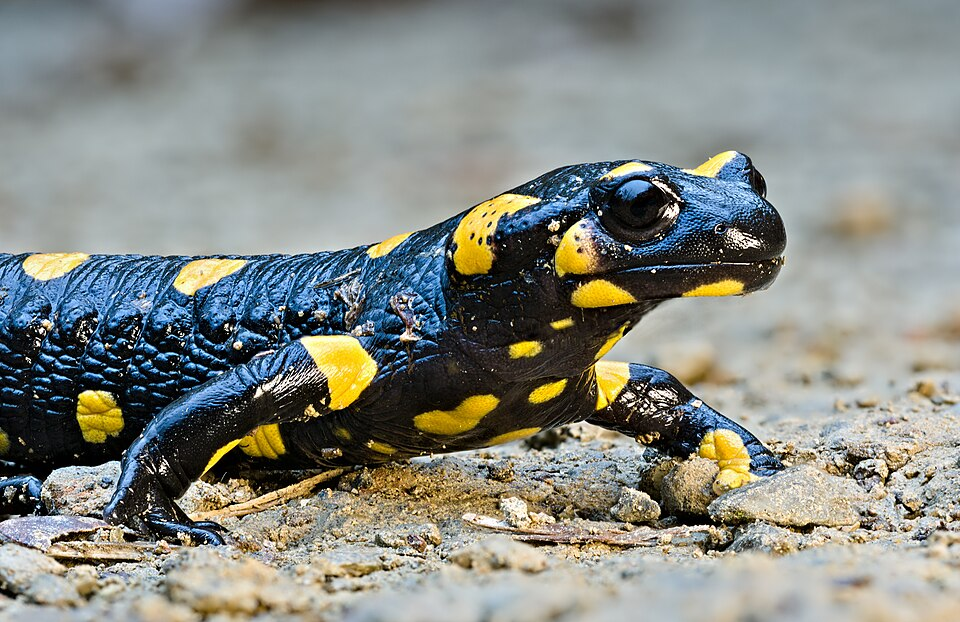
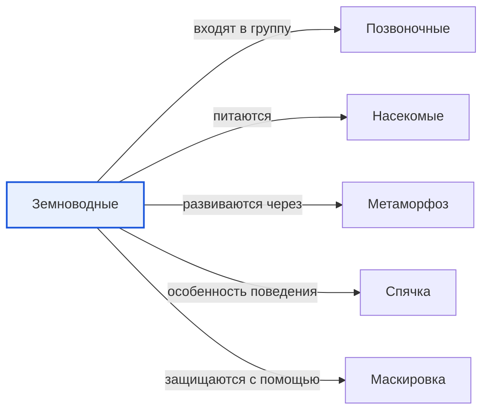

# Земноводные

*Иллюстрация из Wikimedia Commons ([источник](https://commons.wikimedia.org/wiki/File:Fire_salamander_%28Salamandra_Salamandra%29.jpg)).*

<!-- body:start -->
Земноводные, или амфибии, - это [позвоночные животные](vertebrates.md), которые живут «на два дома»: в воде и на суше. Лягушки, жабы, тритоны и саламандры - все земноводные. Название как раз об этом: они водятся и на земле, и в воде.

## Жизнь в воде и на суше

Почти все земноводные начинают жизнь в воде. Лягушка откладывает в пруд икру - много маленьких яиц в прозрачной слизи. Из икринок появляются головастики. Головастик похож на маленькую рыбку: у него есть хвост, и он дышит [жабрами](fish.md). Постепенно у него вырастают лапы, хвост исчезает, жабры сменяются лёгкими, и головастик превращается в лягушку. Такое удивительное [превращение](metamorphosis.md) называется метаморфозом.

Взрослые земноводные дышат лёгкими, но ещё и кожей. Поэтому кожа у них всегда влажная и тонкая. Если она пересохнет, [животное](animals.md) не сможет дышать. Вот почему лягушки и жабы держатся поближе к воде, сырым местам и выходят гулять после дождя.

## Кто такие земноводные

Учёные делят земноводных на три группы:

- **Бесхвостые** - лягушки и жабы. Взрослыми они теряют хвост и становятся отличными прыгунами. Травяную и озёрную лягушку можно встретить в России.
- **Хвостатые** - тритоны и саламандры. Хвост остаётся у них на всю жизнь. Обыкновенный тритон весной живёт в прудах, а летом уходит на сушу.
- **Безногие** - червяги. Они похожи на больших [червей](invertebrates.md) и роют ходы в тропической земле.

## Что едят и как защищаются

Земноводные - охотники. Лягушки и жабы едят [насекомых](insects.md), слизней и червей. Лягушка ловит муху длинным липким языком быстрее, чем ты успеешь моргнуть. Так земноводные помогают уменьшать число комаров и вредителей.

У земноводных много врагов: цапли, аисты, [змеи](reptiles.md), рыбы. Чтобы спастись, многие из них используют [маскировку](camouflage.md) - их зелёная или бурая окраска сливается с травой и тиной. А некоторые, наоборот, ярко окрашены и ядовиты: яркий цвет предупреждает [хищника](predators.md), что такую добычу лучше не трогать.

Зимой земноводные, как и другие холоднокровные животные, впадают в [оцепенение](hibernation.md), похожее на спячку. Они зарываются в ил на дне водоёма или прячутся в норы и под листья.

## Интересные факты

1. Мексиканская амбистома, или аксолотль, может отращивать потерянные лапы и даже части сердца.
2. Аксолотль всю жизнь остаётся похожим на большого головастика с пушистыми жабрами.
3. Некоторые древесные лягушки зимой почти полностью замерзают, а весной оттаивают и оживают.
4. По данным WikiData, мексиканская амбистома находится на грани исчезновения.

## Проверь себя

1. Как головастик превращается в лягушку?
2. Почему кожа земноводных должна быть влажной?
3. На какие три группы делят земноводных?
<!-- body:end -->

## Как это связано с другими понятиями

## Смотри также

- [Позвоночные](vertebrates.md): земноводные → входят в группу → позвоночные
- [Насекомые](insects.md): земноводные → питаются → насекомые
- [Метаморфоз](metamorphosis.md): земноводные → развиваются через → метаморфоз
- [Спячка](hibernation.md): земноводные → особенность поведения → спячка
- [Маскировка](camouflage.md): земноводные → защищаются с помощью → маскировка
- [Все статьи раздела «Животный мир»](../index.md)

## Источники

- WikiData: [Q10908](https://www.wikidata.org/wiki/Q10908)
- Википедия: [земноводные](https://ru.wikipedia.org/wiki/%D0%97%D0%B5%D0%BC%D0%BD%D0%BE%D0%B2%D0%BE%D0%B4%D0%BD%D1%8B%D0%B5)

---
Автор: Бойцов Иван  
*Использованные нейросети: Claude (Anthropic), модель claude-opus-5-5 - генерация текстов статей.*
