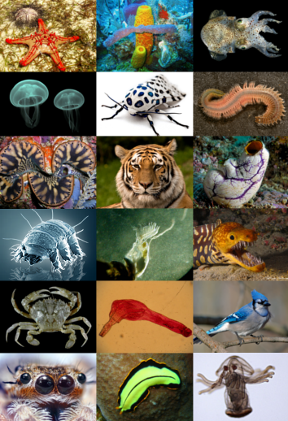
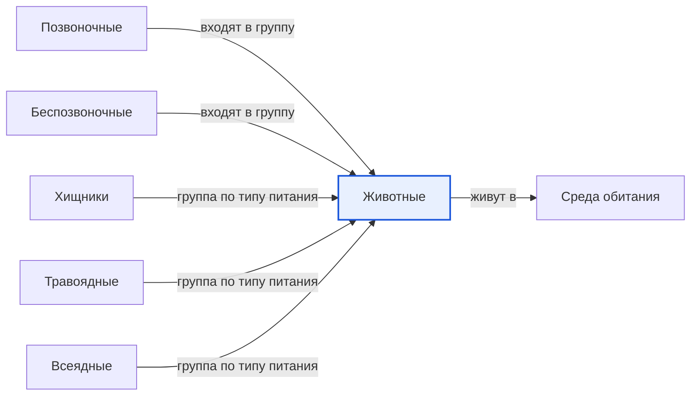

# Животные

*Иллюстрация из Wikimedia Commons ([источник](https://commons.wikimedia.org/wiki/File:Animal_diversity.png)).*

<!-- body:start -->
Животные - это огромная семья [живых существ](../../why_science_help_understand_world/organism.md), в которую входят и крошечный [муравей](insects.md), и гигантский синий кит, и твоя домашняя кошка. Учёные называют её царством животных. Сейчас известно больше полутора миллионов видов животных, и каждый год открывают новые.

## Чем животные отличаются от растений и грибов

Все живые существа на Земле учёные делят на большие группы - царства. [Растения](../../../1.1_ustroystvo_mira/zemlya_priroda_i_klimat/articles/ecosystem.md), грибы и животные - это три разных царства. Как же понять, что перед тобой именно животное?

- **Животные питаются готовой пищей.** [Растение](../../why_science_help_understand_world/nature.md) само делает себе еду из [солнечного света](../../../1.1_ustroystvo_mira/zemlya_priroda_i_klimat/articles/natural_zones.md), воды и воздуха. Животное так не умеет: ему нужно съесть растение, гриб или другое животное.
- **Большинство животных двигаются.** Они бегают, летают, плавают, ползают или прыгают, чтобы найти еду, спастись от опасности или найти себе пару.
- **Животные дышат и чувствуют.** У многих есть органы чувств: глаза, уши, нос, усики. С их помощью животное узнаёт, что происходит вокруг.
- **Тело животного состоит из многих клеток.** Клетка - это крошечный кирпичик, из которого построено любое живое тело. У животных клеток очень много, и они работают вместе.

Бывают и хитрые исключения. Например, взрослый коралл всю жизнь сидит на одном месте и похож на растение, но на самом деле это животное.

## Как учёные делят животных на группы

Чтобы не запутаться среди миллионов видов, учёные раскладывают животных по группам, как книги по полкам. Самое первое деление - по тому, есть ли у животного [позвоночник](vertebrates.md).

**Позвоночные** - животные с позвоночником внутри тела. К ним относятся [млекопитающие](mammals.md), [птицы](birds.md), [пресмыкающиеся](reptiles.md), [земноводные](amphibians.md) и [рыбы](fish.md). Ты тоже позвоночное: потрогай свою спину, и ты нащупаешь позвонки.

**[Беспозвоночные](invertebrates.md)** - животные без позвоночника. Это насекомые, [паукообразные](arachnids.md), черви, улитки, медузы, осьминоги и многие другие. Их на Земле гораздо больше, чем позвоночных.

Ещё животных можно делить по тому, что они едят. [Хищники](predators.md) охотятся на других животных, [травоядные](herbivores.md) едят растения, а [всеядные](omnivores.md) едят и то, и другое. Вместе они образуют [пищевую цепь](food_chain.md), где каждое животное связано с другими.

## Где живут животные

Животные живут почти везде: в лесах и пустынях, в горах и океанах, в ледяной тундре и даже в больших городах. Место, где животное живёт и находит всё нужное для жизни, называется [средой обитания](habitat.md). Белому медведю нужны льды и холодное море, а верблюду - жаркая пустыня.

Чтобы выжить, животные придумали много хитростей. Одни на зиму впадают в [спячку](hibernation.md), другие отправляются в далёкие путешествия, третьи прячутся с помощью [маскировки](camouflage.md). К сожалению, некоторым видам сейчас трудно выжить, и их называют вымирающими.

## Интересные факты

1. Учёные считают, что на Земле может жить несколько миллионов видов животных, которых ещё никто не описал.
2. Самое большое животное, которое когда-либо жило на планете, - синий кит. Он больше любого динозавра.
3. Губки, которые живут на дне моря, тоже животные, хотя у них нет ни головы, ни ног, ни мозга.
4. Больше половины всех известных видов животных - насекомые.

## Проверь себя

1. Чем питание животного отличается от питания растения?
2. На какие две большие группы делят животных по наличию позвоночника?
3. Что такое среда обитания?
<!-- body:end -->

## Как это связано с другими понятиями

## Смотри также

- [Позвоночные](vertebrates.md): позвоночные → входят в группу → животные
- [Беспозвоночные](invertebrates.md): беспозвоночные → входят в группу → животные
- [Хищники](predators.md): хищники → группа по типу питания → животные
- [Травоядные](herbivores.md): травоядные → группа по типу питания → животные
- [Всеядные](omnivores.md): всеядные → группа по типу питания → животные
- [Среда обитания](habitat.md): животные → живут в → среда обитания
- [Все статьи раздела «Животный мир»](../index.md)

## Источники

- WikiData: [Q729](https://www.wikidata.org/wiki/Q729)
- Википедия: [животные](https://ru.wikipedia.org/wiki/%D0%96%D0%B8%D0%B2%D0%BE%D1%82%D0%BD%D1%8B%D0%B5)

---
Автор: Бойцов Иван  
*Использованные нейросети: Claude (Anthropic), модель claude-opus-5-5 - генерация текстов статей.*
