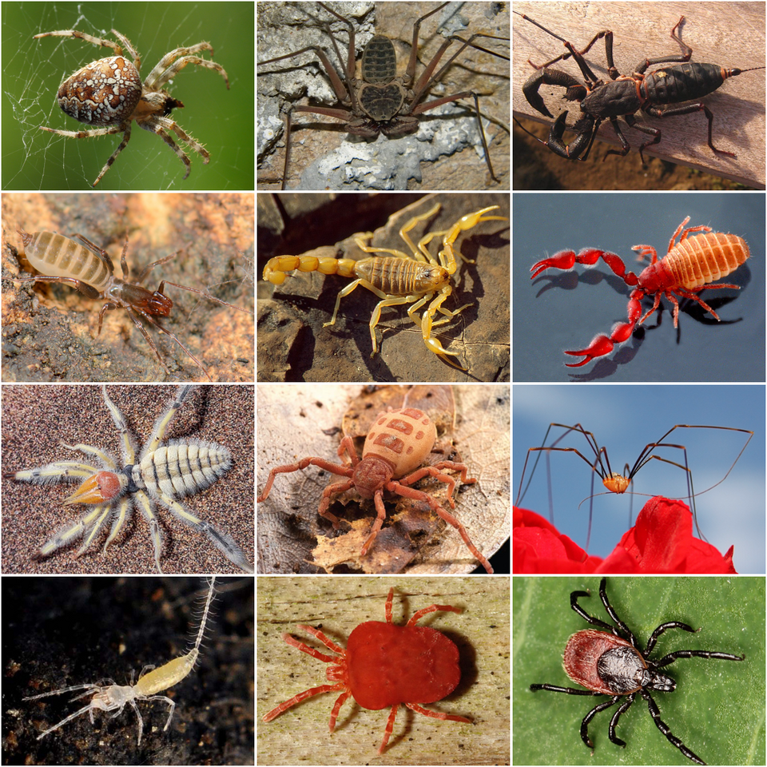
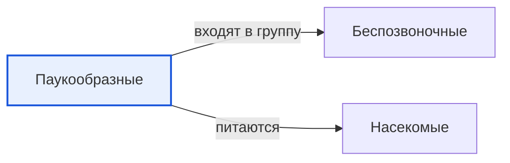

# Паукообразные

*Иллюстрация из Wikimedia Commons ([источник](https://commons.wikimedia.org/wiki/File:Arachnida_collage.png)).*

<!-- body:start -->
Паукообразные - это [беспозвоночные животные](invertebrates.md) с восемью ногами. Пауки, клещи, скорпионы и сенокосцы - всё паукообразные. Многие думают, что паук - это [насекомое](insects.md), но это не так: у насекомых шесть ног, а у паукообразных восемь.

## Чем паук отличается от насекомого

Паукообразные и насекомые - дальние родственники. Те и другие относятся к членистоногим: у них твёрдый наружный панцирь и ноги, сложенные из члеников. Но различий много:

| | Насекомые | Паукообразные |
|:---|:---:|:---:|
| Ноги | 6 | 8 |
| Части тела | 3 (голова, грудь, брюшко) | 2 (головогрудь и брюшко) |
| Усики | есть | нет |
| Крылья | у многих есть | никогда нет |

Глаз у паука обычно восемь, но видят многие пауки не очень хорошо. Зато они прекрасно чувствуют малейшее дрожание паутины.

## Паутина - чудо-нить

Паук делает паутину из особой жидкости, которая выходит из паутинных бородавок на конце брюшка. На [воздухе](../../../1.1_ustroystvo_mira/zemlya_priroda_i_klimat/articles/atmosphere.md) она застывает и превращается в тонкую нить. Паутина очень прочная: если сравнивать нити одинакового веса, паутина бывает крепче стали.

Не все пауки плетут ловчие сети. Крестовик обыкновенный строит красивую круглую паутину и ждёт, когда в неё попадёт муха. А пауки-скакунчики охотятся прыжком, как маленькие кошки.

## Охотники на насекомых

Почти все пауки - [хищники](predators.md). Главная их добыча - насекомые: мухи, комары, тля. Паук кусает добычу и впрыскивает яд, который её обездвиживает. Учёные подсчитали, что пауки на планете за год съедают сотни миллионов тонн насекомых. Без них мух и комаров стало бы гораздо больше. Для человека подавляющее большинство пауков совсем не опасны.

## Какие ещё бывают паукообразные

По данным WikiData, среди паукообразных есть несколько отрядов:

- **Пауки** - самый большой и известный отряд.
- **Скорпионы** - у них есть клешни и хвост с ядовитым жалом на конце. Они живут в жарких местах.
- **Клещи** - очень маленькие. Некоторые клещи цепляются к [животным](animals.md) и людям и пьют кровь, поэтому после прогулки в лесу нужно осматривать одежду и кожу.
- **Сенокосцы** - паукообразные с очень длинными тонкими ногами. Паутину они не плетут.

## Интересные факты

1. Самые маленькие пауки размером меньше макового зёрнышка.
2. Скорпионы светятся голубоватым светом, если посветить на них ультрафиолетовой лампой.
3. Многие маленькие паучки умеют «летать»: они выпускают длинную паутинку, и [ветер](../../../1.1_ustroystvo_mira/zemlya_priroda_i_klimat/articles/climate.md) уносит их далеко-далеко.
4. Паук-серебрянка живёт под водой в «колоколе» из паутины, наполненном [воздухом](../../why_science_help_understand_world/environmental_sciences.md).

## Проверь себя

1. Сколько ног у паукообразных и сколько у насекомых?
2. Из чего паук делает паутину?
3. Чем пауки полезны для природы и человека?
<!-- body:end -->

## Как это связано с другими понятиями

## Смотри также

- [Беспозвоночные](invertebrates.md): паукообразные → входят в группу → беспозвоночные
- [Насекомые](insects.md): паукообразные → питаются → насекомые
- [Все статьи раздела «Животный мир»](../index.md)

## Источники

- WikiData: [Q1358](https://www.wikidata.org/wiki/Q1358)
- Википедия: [паукообразные](https://ru.wikipedia.org/wiki/%D0%9F%D0%B0%D1%83%D0%BA%D0%BE%D0%BE%D0%B1%D1%80%D0%B0%D0%B7%D0%BD%D1%8B%D0%B5)

---
Автор: Цыбулько Даниил  
*Использованные нейросети: Claude (Anthropic), модель claude-opus-5-5 - генерация текстов статей.*
