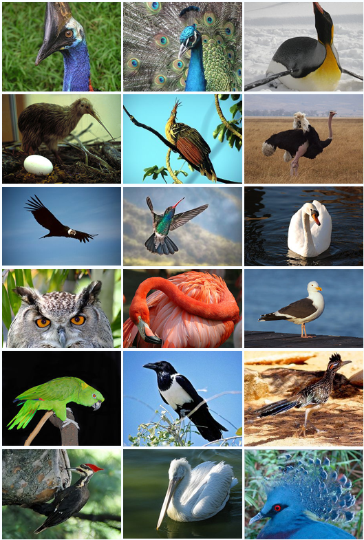
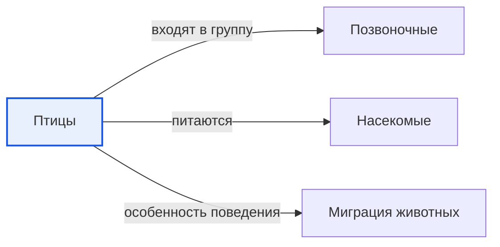

# Птицы

*Иллюстрация из Wikimedia Commons ([источник](https://commons.wikimedia.org/wiki/File:Bird_Diversity_2011.png)).*

<!-- body:start -->
Птицы - это [позвоночные животные](vertebrates.md), покрытые перьями, у которых вместо передних лап крылья, а вместо зубов клюв. Воробей за окном, курица в деревне, пингвин в Антарктиде и орёл в горах - все они птицы. Перья есть только у птиц и больше ни у кого из ныне живущих [животных](animals.md).

## Как устроена птица

Тело птицы как будто специально придумано для полёта:

- **Перья.** Они лёгкие и прочные. Маховые перья на крыльях держат птицу в [воздухе](../../../1.1_ustroystvo_mira/zemlya_priroda_i_klimat/articles/atmosphere.md), пуховые перья греют её, как одеяло.
- **Полые кости.** Многие кости у птиц внутри пустые, с тонкими перегородками. Поэтому скелет лёгкий, но крепкий.
- **Сильное сердце и лёгкие.** Птица дышит очень хитро: [воздух](../../why_science_help_understand_world/environmental_sciences.md) проходит через лёгкие в одном направлении, и птица получает много кислорода даже высоко в небе.
- **Клюв.** По форме клюва можно угадать, что ест птица. Короткий толстый клюв у клеста помогает доставать семена из шишек, длинный клюв у цапли - ловить [рыбу](fish.md), крючковатый клюв у орла - разрывать [добычу](predators.md).

Птицы теплокровные: их тело всегда тёплое, поэтому они могут жить даже в самых холодных местах Земли.

## Яйца и гнёзда

Все птицы откладывают яйца. Родители строят гнёзда из веточек, травы, глины или пуха и высиживают яйца, согревая их своим телом. Когда птенцы вылупляются, родители кормят их. У многих видов птенцы рождаются голыми и слепыми, и мама с папой без устали носят им еду. Многие птицы едят [насекомых](insects.md) и приносят их своим птенцам, так что птицы помогают защищать сады и леса от вредителей.

## Какие бывают птицы

Учёные делят птиц на отряды. Среди них есть курообразные (куры, глухари), гусеобразные (гуси, утки, лебеди), совообразные (совы), аистообразные (аисты), соколообразные (соколы). Не все птицы летают: страус, пингвин и киви ходят пешком, а пингвин ещё и отлично плавает.

## Птицы-путешественники

Осенью многие птицы улетают на юг, а весной возвращаются. Такие путешествия называются [миграцией](migration.md). Белый аист и серый журавль каждый год пролетают тысячи километров, чтобы перезимовать в тёплых краях, где хватает еды.

## Интересные факты

1. Учёные считают, что птицы произошли от небольших хищных динозавров. Можно сказать, что голубь - дальний родственник тираннозавра.
2. Колибри может летать задом наперёд и зависать в воздухе на одном месте.
3. Полярная крачка совершает самое длинное путешествие среди животных: каждый год она летит из [Арктики](../../../1.1_ustroystvo_mira/zemlya_priroda_i_klimat/articles/natural_zones.md) в Антарктику и обратно.
4. Сапсан, пикируя на добычу, может развивать скорость больше 300 километров в час.

## Проверь себя

1. Какой признак есть только у птиц?
2. Почему скелет птицы лёгкий, но прочный?
3. Как по клюву можно догадаться, что ест птица?
<!-- body:end -->

## Как это связано с другими понятиями

## Смотри также

- [Позвоночные](vertebrates.md): птицы → входят в группу → позвоночные
- [Насекомые](insects.md): птицы → питаются → насекомые
- [Миграция животных](migration.md): птицы → особенность поведения → миграция животных
- [Все статьи раздела «Животный мир»](../index.md)

## Источники

- WikiData: [Q5113](https://www.wikidata.org/wiki/Q5113)
- Википедия: [птицы](https://ru.wikipedia.org/wiki/%D0%9F%D1%82%D0%B8%D1%86%D1%8B)

---
Автор: Бойцов Иван  
*Использованные нейросети: Claude (Anthropic), модель claude-opus-5-5 - генерация текстов статей.*
