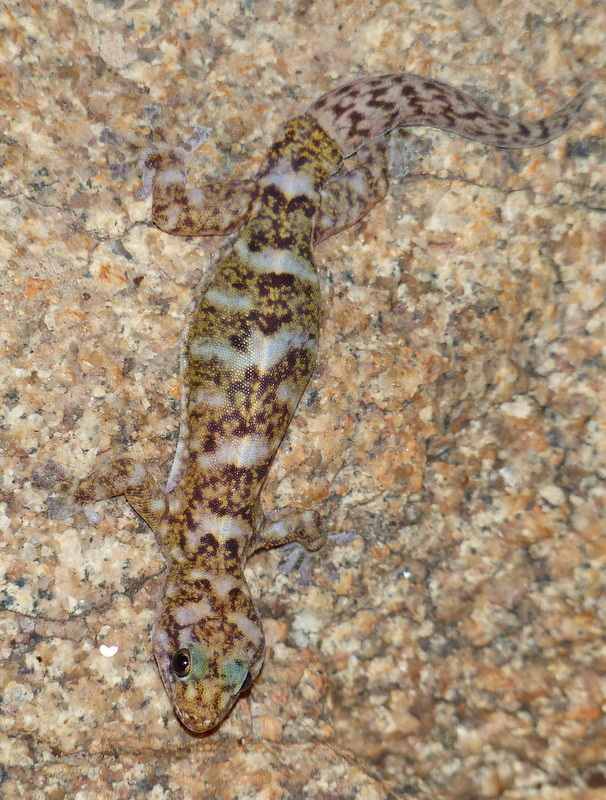
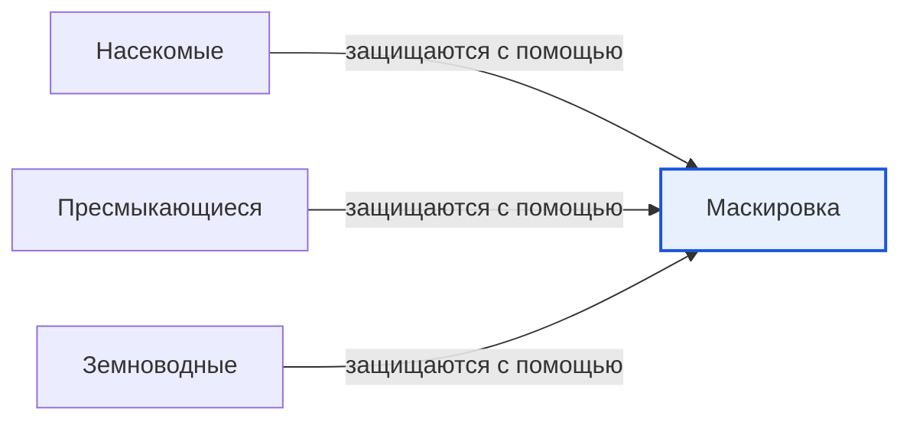

# Маскировка

*Иллюстрация из Wikimedia Commons ([источник](https://commons.wikimedia.org/wiki/File:Transvaal_flat_gecko_%28Afroedura_transvaalica%29.jpg)).*

<!-- body:start -->
Маскировка - это умение [животного](animals.md) становиться незаметным, сливаясь с тем, что его окружает. Окраска, узоры и форма тела помогают ему спрятаться так, что его не видно даже в двух шагах. Учёные называют такую окраску защитной. На картинке в начале статьи - геккон на гранитном камне. Посмотри, как его пятнышки повторяют узор камня.

## Зачем животным прятаться

Маскировка нужна и тем, кто убегает, и тем, кто догоняет:

- **Чтобы спастись.** Если [хищник](predators.md) не заметит добычу, он её не поймает. Поэтому многие [насекомые](insects.md), [ящерицы](reptiles.md), [лягушки](amphibians.md) и маленькие птички окрашены под цвет листьев, коры, травы или песка.
- **Чтобы охотиться.** Хищнику тоже выгодно быть незаметным, тогда добыча не убежит. Полосатый тигр прячется в высокой траве, а белая [полярная сова](../../../1.1_ustroystvo_mira/zemlya_priroda_i_klimat/articles/tundra.md) сливается со снегом.

## Способы маскировки

**Цвет как у окружения.** Кузнечик зелёный, как трава, а ящерица в [пустыне](../../../1.1_ustroystvo_mira/zemlya_priroda_i_klimat/articles/desert.md) - песочного цвета. Камбала лежит на дне моря и подстраивает окраску под песок и камешки.

**Смена наряда по сезону.** Заяц-беляк летом бурый, а к зиме линяет и становится белоснежным. Так он прячется и в летнем лесу, и в зимнем.

**Быстрая смена цвета.** Хамелеон знаменит тем, что умеет менять цвет кожи. Учёные выяснили, что хамелеон меняет цвет не только чтобы прятаться, но и чтобы показать настроение, согреться или остыть. А осьминоги и каракатицы меняют окраску и даже узор кожи за доли секунды.

**Похожесть на предметы.** Палочник выглядит как сухая веточка, а некоторые бабочки, сложив крылья, становятся похожи на сухой лист с прожилками. Богомол прячется среди листьев и цветов, поджидая добычу.

**Мимикрия.** Это когда безобидное животное притворяется опасным. Например, некоторые мухи окрашены в жёлто-чёрные полоски, как осы. [Птицы](birds.md) боятся ос и не трогают таких мух, хотя у мухи нет жала.

## Предупреждающая окраска

Бывает и наоборот: некоторые животные вовсе не прячутся, а носят очень яркие цвета. Обычно это значит: «Я ядовитый, не трогай!». Так окрашены божья коровка, некоторые лягушки-древолазы и осы. Хищник, однажды попробовавший такую добычу, запоминает яркий цвет и больше её не трогает.

Маскировкой пользуются очень разные животные: насекомые, пресмыкающиеся, земноводные, [рыбы](fish.md), птицы и [млекопитающие](mammals.md). Это одно из главных [приспособлений](habitat.md) к жизни в своей среде обитания.

## Интересные факты

1. Некоторые палочники - одни из самых длинных насекомых на Земле: они бывают длиной больше полуметра.
2. Каракатица может менять окраску, хотя, по мнению учёных, сама видит цвета не так, как мы.
3. Морской конёк-тряпичник похож на плавающие водоросли.
4. Белые медведи на самом деле имеют чёрную кожу, а их шерсть кажется белой, поэтому они незаметны на снегу.

## Проверь себя

1. Кому маскировка помогает - добыче или хищнику?
2. Как заяц-беляк прячется и летом, и зимой?
3. Что такое мимикрия?
<!-- body:end -->

## Как это связано с другими понятиями

## Смотри также

- [Насекомые](insects.md): насекомые → защищаются с помощью → маскировка
- [Пресмыкающиеся](reptiles.md): пресмыкающиеся → защищаются с помощью → маскировка
- [Земноводные](amphibians.md): земноводные → защищаются с помощью → маскировка
- [Все статьи раздела «Животный мир»](../index.md)

## Источники

- WikiData: [Q196327](https://www.wikidata.org/wiki/Q196327)
- Википедия: [защитная окраска](https://ru.wikipedia.org/wiki/%D0%97%D0%B0%D1%89%D0%B8%D1%82%D0%BD%D0%B0%D1%8F_%D0%BE%D0%BA%D1%80%D0%B0%D1%81%D0%BA%D0%B0)

---
Автор: Дудовцев Андрей  
*Использованные нейросети: Claude (Anthropic), модель claude-opus-5-5 - генерация текстов статей.*
