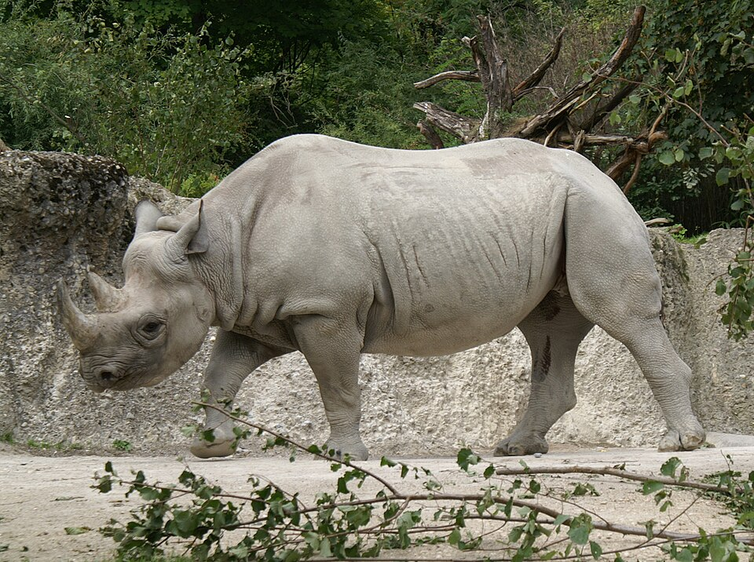
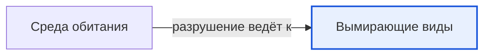

# Вымирающие виды

*Иллюстрация из Wikimedia Commons ([источник](https://commons.wikimedia.org/wiki/File:Ostafrikanisches_Spitzmaulnashorn.JPG)).*

<!-- body:start -->
Вымирающие виды - это [животные](animals.md) и [растения](../../../1.1_ustroystvo_mira/zemlya_priroda_i_klimat/articles/ecosystem.md), которых на Земле осталось так мало, что они могут совсем исчезнуть. Если вид вымрет, его больше никогда не будет на нашей планете: ни в лесу, ни в зоопарке. Поэтому учёные внимательно следят за редкими животными и стараются их спасти.

## Почему виды исчезают

Вымирание случалось и раньше: например, много миллионов лет назад исчезли динозавры. Но сейчас виды исчезают гораздо быстрее, чем обычно, и чаще всего из-за людей. Вот главные причины:

- **Разрушение [среды обитания](habitat.md).** Люди вырубают леса, осушают болота, распахивают [степи](../../../1.1_ustroystvo_mira/zemlya_priroda_i_klimat/articles/natural_zones.md) и строят города. Животным становится негде жить и нечего есть. Это самая главная причина.
- **[Охота](predators.md) и браконьерство.** Браконьеры - это люди, которые охотятся незаконно. Например, носорогов убивают ради рогов, а тигров - ради шкур.
- **[Загрязнение](../../why_science_help_understand_world/environmental_sciences.md).** Мусор, [пластик](../../../1.1_ustroystvo_mira/zemlya_priroda_i_klimat/articles/environmental_pollution.md) и ядовитые вещества попадают в реки и моря и вредят [рыбам](fish.md), [птицам](birds.md) и [черепахам](reptiles.md).
- **Изменение климата.** Когда становится теплее, тают льды, и белым медведям всё труднее охотиться на тюленей.
- **Чужие животные.** Если завезти в новое место кошек, крыс или лис, они могут съесть местных животных, которые не умеют от них защищаться.

## Как учёные следят за редкими видами

Международный союз охраны природы (МСОП) составляет большой список, в котором для каждого вида указано, насколько ему грозит опасность. Самые тревожные отметки - «вымирающий вид» и «на грани исчезновения». В России есть своя Красная книга - список редких животных и растений, которых особенно нужно беречь. Её назвали красной потому, что красный цвет означает «Внимание, опасность!».

По данным WikiData, среди самых известных животных с такими статусами:

- **Чёрный носорог** (на картинке в начале статьи) - находится на грани исчезновения.
- **Какапо** - толстый ночной попугай из Новой Зеландии, который не умеет летать.
- **Яванский** и **суматранский носороги** - их осталось совсем мало.
- **Европейская норка** - маленький пушистый зверёк, который живёт у рек, в том числе в России.
- **Мексиканская амбистома** (аксолотль) и **речной угорь** - среди [земноводных](amphibians.md) и рыб тоже есть вымирающие виды.

## Как людям удаётся спасать животных

Есть и хорошие новости. Если вовремя взяться за дело, вид можно спасти:

- **Заповедники и национальные парки.** Это охраняемые места, где нельзя охотиться, рубить лес и строить. Животные живут там спокойно.
- **Запрет охоты.** Когда охоту на амурского тигра запретили, тигров снова стало больше.
- **Разведение в неволе.** Редких животных разводят в зоопарках и питомниках, а потом выпускают на волю.
- **Защита среды обитания.** Самый надёжный способ помочь животным - сохранить леса, реки и моря, где они живут.

## Как можешь помочь ты

Даже ребёнок может сделать многое: не оставлять мусор на природе, не трогать гнёзда и норы, беречь воду и бумагу, подкармливать птиц зимой и рассказывать друзьям о редких животных.

## Интересные факты

1. В середине прошлого века амурских тигров оставалось меньше сотни, а сейчас их несколько сотен благодаря охране.
2. Каждого какапо учёные знают по имени - так их мало.
3. Большая панда долго считалась вымирающим видом, но благодаря заповедникам её положение улучшилось, и статус панды смягчили.
4. Слово «браконьер» пришло из французского языка и раньше означало охотника с собаками.

## Проверь себя

1. Какая причина вымирания животных самая главная?
2. Что такое Красная книга и почему она так называется?
3. Как заповедники помогают сохранить редких животных?
<!-- body:end -->

## Как это связано с другими понятиями

## Смотри также

- [Среда обитания](habitat.md): среда обитания → разрушение ведёт к → вымирающие виды
- [Все статьи раздела «Животный мир»](../index.md)

## Источники

- WikiData: [Q11394](https://www.wikidata.org/wiki/Q11394)
- Википедия: [вымирающие виды](https://ru.wikipedia.org/wiki/%D0%92%D1%8B%D0%BC%D0%B8%D1%80%D0%B0%D1%8E%D1%89%D0%B8%D0%B5_%D0%B2%D0%B8%D0%B4%D1%8B)

---
Автор: Дудовцев Андрей  
*Использованные нейросети: Claude (Anthropic), модель claude-opus-5-5 - генерация текстов статей.*
