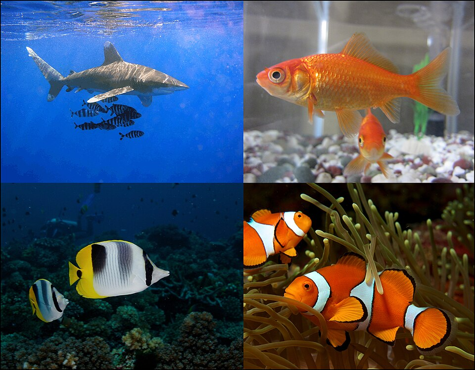

# Рыбы

*Иллюстрация из Wikimedia Commons ([источник](https://commons.wikimedia.org/wiki/File:Fish-coll002.jpg)).*

<!-- body:start -->
Рыбы - это [позвоночные животные](vertebrates.md), которые живут в воде и дышат жабрами. Карась в пруду, щука в реке, акула в [океане](../../../1.1_ustroystvo_mira/zemlya_priroda_i_klimat/articles/water_cycle.md) - все они рыбы. Рыбы появились на Земле раньше всех других позвоночных, и от древних рыб произошли все остальные позвоночные, в том числе и мы.

## Как рыба дышит под водой

Нам, чтобы дышать, нужен [воздух](../../../1.1_ustroystvo_mira/zemlya_priroda_i_klimat/articles/atmosphere.md). Рыбе тоже нужен кислород, но она берёт его прямо из воды. Для этого у неё есть жабры - тонкие красные пластинки по бокам головы, спрятанные под жаберными крышками. Рыба набирает воду ртом, вода проходит через жабры, и они забирают из неё растворённый кислород. Если вытащить рыбу из воды, жабры слипнутся, и она не сможет дышать.

## Как устроено тело рыбы

- **Обтекаемая форма.** Тело рыбы вытянутое и гладкое, поэтому вода легко его обтекает.
- **Плавники.** Хвостовой плавник толкает рыбу вперёд, а остальные помогают поворачивать, тормозить и держать равновесие.
- **Чешуя.** У многих рыб тело покрыто чешуёй, как черепицей. Она защищает от ран, а слизь сверху помогает скользить в воде.
- **Плавательный пузырь.** Это мешочек с газом внутри тела. Наполняя или опустошая его, рыба может подниматься и опускаться, не тратя сил.
- **Боковая линия.** Вдоль боков у рыбы есть особые чувствительные клетки. Ими она чувствует движение воды и замечает [добычу](predators.md) или врага даже в мутной воде.

Рыбы холоднокровные: температура их тела почти такая же, как у воды вокруг.

## Какие бывают рыбы

Самая большая группа - **костные рыбы**. Их скелет состоит из костей. Это щука, карась, лосось, треска, угорь и многие другие. В WikiData среди их отрядов есть, например, угреобразные, трескообразные и удильщикообразные.

Другая группа - **хрящевые рыбы**: акулы и скаты. Их скелет сделан из хряща, такого же гибкого материала, как у тебя в ухе. У хрящевых рыб нет плавательного пузыря, поэтому многим акулам приходится всё время плыть, чтобы не опуститься на дно.

Некоторые рыбы совершают далёкие путешествия. Атлантический лосось рождается в реке, вырастает в море, а потом возвращается в ту же самую реку, чтобы отложить икру. Такие путешествия называются [миграцией](migration.md).

## Интересные факты

1. Самая большая рыба - китовая акула. Она может быть длиной с автобус, но питается крошечными рачками.
2. Удильщик живёт в тёмной глубине и приманивает добычу светящимся «фонариком» на голове.
3. Электрический скат может ударить током, чтобы оглушить добычу или отпугнуть врага.
4. По данным WikiData, речной угорь находится на грани исчезновения.

## Проверь себя

1. Как рыба получает кислород из воды?
2. Зачем рыбе плавательный пузырь?
3. Чем хрящевые рыбы отличаются от костных?
<!-- body:end -->

## Как это связано с другими понятиями

## Смотри также

- [Позвоночные](vertebrates.md): рыбы → входят в группу → позвоночные
- [Миграция животных](migration.md): рыбы → особенность поведения → миграция животных
- [Все статьи раздела «Животный мир»](../index.md)

## Источники

- WikiData: [Q152](https://www.wikidata.org/wiki/Q152)
- Википедия: [рыбы](https://ru.wikipedia.org/wiki/%D0%A0%D1%8B%D0%B1%D1%8B)

---
Автор: Бойцов Иван  
*Использованные нейросети: Claude (Anthropic), модель claude-opus-5-5 - генерация текстов статей.*
