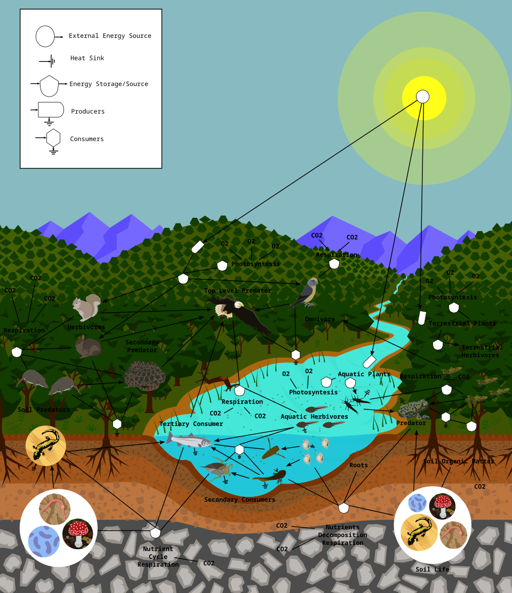
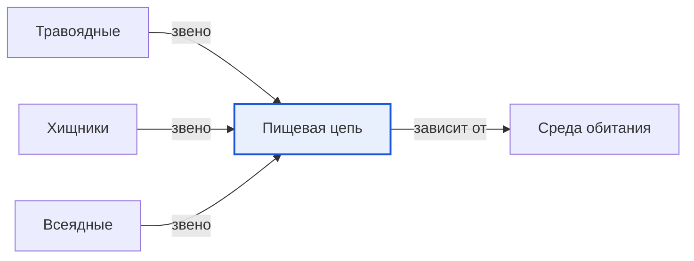

# Пищевая цепь

*Иллюстрация из Wikimedia Commons ([источник](https://commons.wikimedia.org/wiki/File:FoodWeb.svg)).*

<!-- body:start -->
Пищевая цепь - это цепочка [живых существ](../../why_science_help_understand_world/organism.md), в которой каждое следующее питается предыдущим. Например: трава - заяц - лиса. Заяц ест траву, а лиса ест зайца. Каждое существо в такой цепочке называется звеном, как колечко в настоящей цепи.

## С чего начинается цепь

Почти любая пищевая цепь начинается с [растений](../../../1.1_ustroystvo_mira/zemlya_priroda_i_klimat/articles/ecosystem.md). [Растения](../../why_science_help_understand_world/nature.md) - удивительные существа: они умеют сами делать себе еду из [солнечного света](../../../1.1_ustroystvo_mira/zemlya_priroda_i_klimat/articles/natural_zones.md), воды и воздуха. Поэтому растения называют производителями. Вся энергия, которая потом путешествует по цепи, сначала была солнечным светом, пойманным листьями.

## Звенья пищевой цепи

Давай разберём цепь по шагам:

1. **Растения** - первое звено. Трава, листья, ягоды, семена.
2. **[Травоядные](herbivores.md)** - второе звено. Заяц, косуля, кузнечик, [гусеница](insects.md) едят растения.
3. **[Хищники](predators.md)** - следующие звенья. Лиса ест зайца, [лягушка](amphibians.md) ловит кузнечика, а цаплю, которая съела лягушку, может поймать орёл.
4. **Разрушители** - особое звено. Это грибы, бактерии и дождевые [черви](invertebrates.md). Учёные называют их редуцентами. Они перерабатывают опавшие листья, остатки растений и [животных](animals.md) и превращают их в питательные вещества для почвы. А из почвы эти вещества снова забирают растения. Так цепь замыкается в круг.

[Всеядные животные](omnivores.md), например медведь или кабан, могут занимать сразу несколько мест в цепи.

## Цепь или паутина?

В настоящей природе всё сложнее, чем одна цепочка. Заяц может стать добычей не только лисы, но и волка, рыси или орла. А лиса ест не только зайцев, но и мышей, [птиц](birds.md), ягоды. Если нарисовать все эти связи, получится не цепь, а целая паутина. Учёные так и называют её - пищевая сеть. На картинке в начале статьи показана как раз такая сеть: стрелки идут от еды к тому, кто её ест.

## Что будет, если звено пропадёт

Все звенья пищевой цепи зависят друг от друга. Если одно звено исчезнет, пострадают и другие.

Например, если люди уничтожат всех волков в лесу, олени расплодятся и объедят молодые деревья. Лес начнёт редеть, и пострадают птицы, которые в нём гнездились. А если исчезнут насекомые, то птицам и лягушкам станет нечего есть.

Пищевая цепь тесно связана со [средой обитания](habitat.md). Если вырубить лес или осушить болото, разрушится сразу много цепочек. Поэтому так важно беречь природу целиком, а не только отдельных животных.

## Интересные факты

1. В пищевой цепи обычно бывает не больше пяти-шести звеньев: на каждом шаге большая часть энергии тратится на жизнь животного и не переходит дальше.
2. Растений по весу на Земле гораздо больше, чем всех животных вместе взятых.
3. Самые большие животные на планете - синий кит и китовая [акула](fish.md) - питаются крошечными рачками, то есть стоят в очень короткой цепи.
4. Дождевые черви за год пропускают через себя огромное количество земли и делают её плодородной.

## Проверь себя

1. С чего обычно начинается пищевая цепь?
2. Кто такие редуценты и зачем они нужны?
3. Чем пищевая сеть отличается от пищевой цепи?
<!-- body:end -->

## Как это связано с другими понятиями

## Смотри также

- [Травоядные](herbivores.md): травоядные → звено → пищевая цепь
- [Хищники](predators.md): хищники → звено → пищевая цепь
- [Всеядные](omnivores.md): всеядные → звено → пищевая цепь
- [Среда обитания](habitat.md): пищевая цепь → зависит от → среда обитания
- [Все статьи раздела «Животный мир»](../index.md)

## Источники

- WikiData: [Q159462](https://www.wikidata.org/wiki/Q159462)
- Википедия: [пищевая цепь](https://ru.wikipedia.org/wiki/%D0%9F%D0%B8%D1%89%D0%B5%D0%B2%D0%B0%D1%8F_%D1%86%D0%B5%D0%BF%D1%8C)

---
Автор: Цыбулько Даниил  
*Использованные нейросети: Claude (Anthropic), модель claude-opus-5-5 - генерация текстов статей.*
