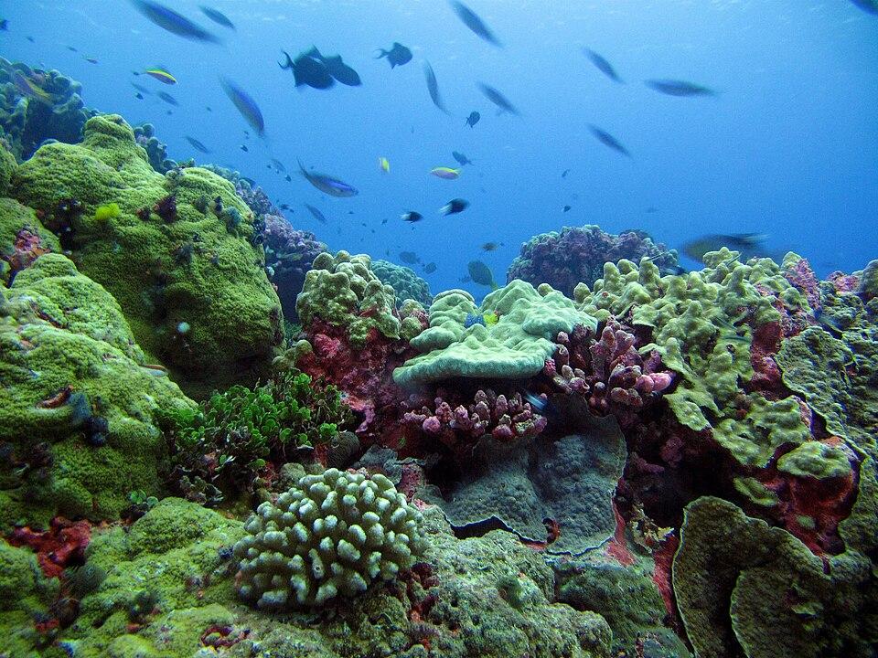
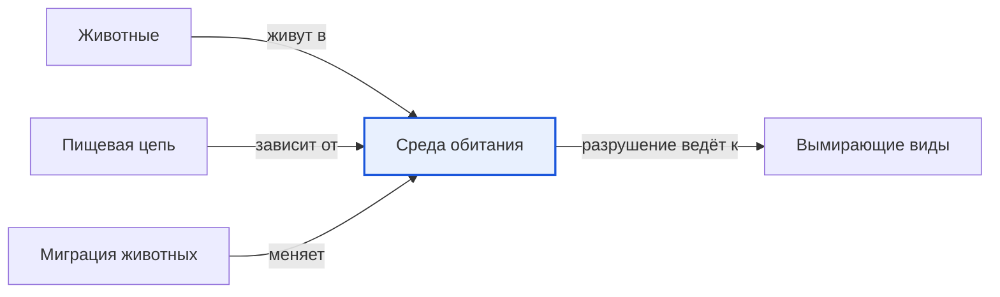

# Среда обитания

*Иллюстрация из Wikimedia Commons ([источник](https://commons.wikimedia.org/wiki/File:Rotjan_-_Enderbury_Day_1_-_2nd_half_%2862%29.JPG)).*

<!-- body:start -->
Среда обитания - это место, где [животное](animals.md) живёт и находит всё, что ему нужно: еду, воду, укрытие и место для детёнышей. Для белки это лес, для [верблюда](../../../1.1_ustroystvo_mira/zemlya_priroda_i_klimat/articles/desert.md) - [пустыня](../../../1.1_ustroystvo_mira/zemlya_priroda_i_klimat/articles/natural_zones.md), для [акулы](fish.md) - [океан](../../../1.1_ustroystvo_mira/zemlya_priroda_i_klimat/articles/water_cycle.md), а для голубя - городская улица. Учёные называют такое место ещё местообитанием.

## Какие бывают среды обитания

На Земле очень много разных мест, где живут животные:

- **Лес** - дом для белок, лосей, медведей, дятлов и множества [насекомых](insects.md). Здесь много укрытий и еды.
- **Степь и саванна** - открытые пространства, поросшие травой. Здесь живут быстрые [травоядные](herbivores.md) - антилопы, зебры, сайгаки - и [хищники](predators.md), которые на них охотятся.
- **[Пустыня](../../../1.1_ustroystvo_mira/zemlya_priroda_i_klimat/articles/biosphere.md)** - жарко днём, холодно ночью и очень мало воды. Здесь живут верблюды, [ящерицы](reptiles.md), змеи, [скорпионы](arachnids.md).
- **Тундра и Арктика** - холодные края с долгой зимой. Здесь обитают белый медведь, песец, северный олень.
- **Пресные водоёмы** - реки, озёра и пруды. Здесь живут рыбы, [лягушки](amphibians.md), утки, бобры.
- **Моря и океаны** - самая большая среда обитания на планете. Здесь живут киты, дельфины, [медузы](invertebrates.md), кораллы и огромное количество рыб. На картинке в начале статьи - коралловый риф, настоящий подводный город.
- **Город** - да, город тоже среда обитания. Голуби, воробьи, вороны, крысы и даже лисы научились жить рядом с людьми.

## Как животные приспосабливаются

Каждое животное подходит к своей среде, как ключ к замку. Такие особенности называются приспособлениями.

- **Белый медведь** живёт среди льда и снега. У него толстый слой жира, густой мех и широкие лапы, которые не проваливаются в снег.
- **Верблюд** живёт в пустыне. Он может долго обходиться без воды, а в горбах запасает жир. Длинные ресницы защищают его глаза от песка.
- **Горбатый кит** живёт в океане. Его тело обтекаемое, как у рыбы, а толстый слой жира греет в холодной воде.
- **Рыбы** дышат жабрами, а [птицы](birds.md) - лёгкими, приспособленными к полёту. Каждый устроен для своей среды.

## Когда среда обитания меняется

Иногда среда обитания меняется сама: наступает зима, пересыхает озеро, пропадает еда. Тогда животные спасаются по-разному. Одни отправляются в дальний путь - это называется [миграцией](migration.md). Другие впадают в [спячку](hibernation.md) и пережидают трудное время.

Но бывает, что среду обитания разрушают люди: вырубают леса, осушают болота, загрязняют реки. Если животному некуда уйти, оно может погибнуть. Именно потеря места для жизни - одна из главных причин, почему многие виды становятся вымирающими.

## Интересные факты

1. Животные живут даже в самых неожиданных местах: в горячих источниках, в глубоких пещерах и на дне океана, куда никогда не проникает солнечный свет.
2. Глубоководная рыба-удильщик живёт в полной темноте и приманивает добычу собственным светящимся «фонариком».
3. Некоторые животные меняют среду обитания за жизнь: лягушка начинает жизнь в воде, а потом выходит на сушу.
4. Коралловые рифы занимают очень мало места в океане, но в них живёт огромная часть всех морских видов.

## Проверь себя

1. Что животное находит в своей среде обитания?
2. Как белый медведь приспособлен к жизни среди льда?
3. Почему разрушение среды обитания опасно для животных?
<!-- body:end -->

## Как это связано с другими понятиями

## Смотри также

- [Животные](animals.md): животные → живут в → среда обитания
- [Пищевая цепь](food_chain.md): пищевая цепь → зависит от → среда обитания
- [Миграция животных](migration.md): миграция животных → меняет → среда обитания
- [Вымирающие виды](endangered_species.md): среда обитания → разрушение ведёт к → вымирающие виды
- [Все статьи раздела «Животный мир»](../index.md)

## Источники

- WikiData: [Q52105](https://www.wikidata.org/wiki/Q52105)
- Википедия: [местообитание](https://ru.wikipedia.org/wiki/%D0%9C%D0%B5%D1%81%D1%82%D0%BE%D0%BE%D0%B1%D0%B8%D1%82%D0%B0%D0%BD%D0%B8%D0%B5)

---
Автор: Дудовцев Андрей  
*Использованные нейросети: Claude (Anthropic), модель claude-opus-5-5 - генерация текстов статей.*
