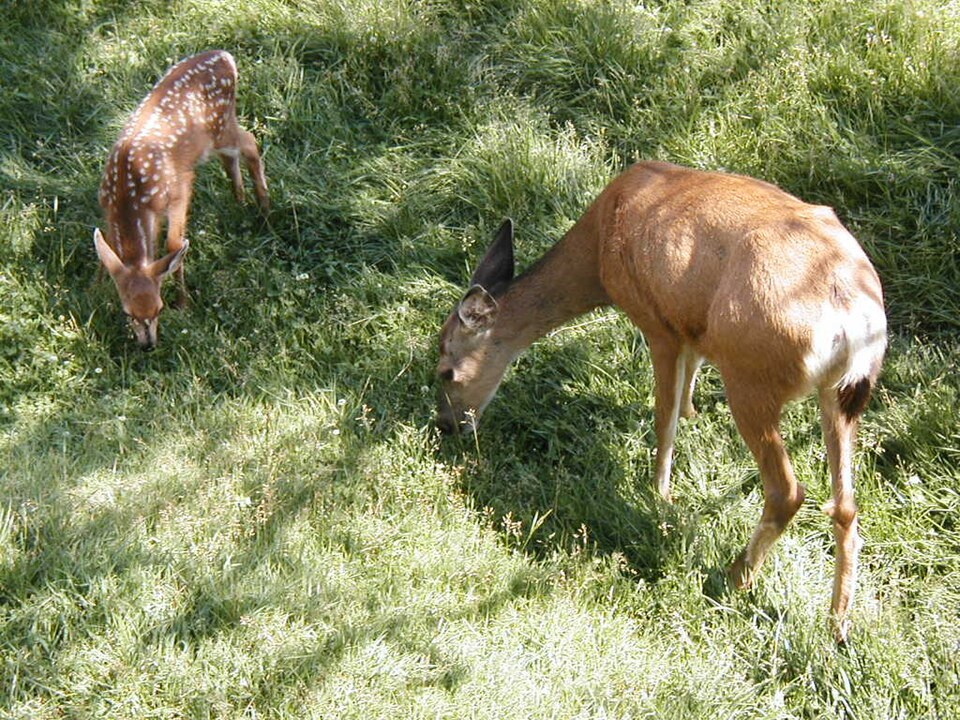
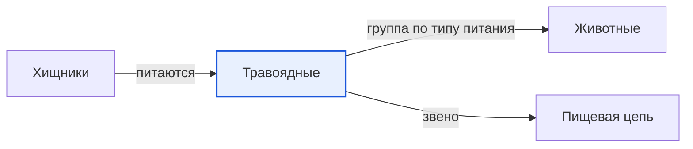

# Травоядные

*Иллюстрация из Wikimedia Commons ([источник](https://commons.wikimedia.org/wiki/File:Fawn_and_mother.jpg)).*

<!-- body:start -->
Травоядные - это [животные](animals.md), которые питаются [растениями](../../../1.1_ustroystvo_mira/zemlya_priroda_i_klimat/articles/ecosystem.md): травой, листьями, ветками, корой, плодами и семенами. Учёные называют их ещё растительноядными. Корова, лошадь, заяц, лось, косуля, жираф и слон - все они травоядные.

## Трудная еда - трава

Кажется, что есть траву легко: она растёт повсюду и никуда не убегает. Но у травы есть секрет. В [растениях](../../why_science_help_understand_world/nature.md) много очень прочного [вещества](../../../1.1_structure_of_the_world/matter/articles/01_matter.md) - клетчатки. Переварить её непросто, а питательных [веществ](../../why_science_help_understand_world/physical_science.md) в траве мало. Поэтому травоядным приходится есть много и долго. Корова, например, жуёт почти весь день.

Чтобы справиться с такой едой, у травоядных есть особые [приспособления](habitat.md):

- **Широкие плоские зубы.** Ими удобно перетирать траву, как жерновами на мельнице. Передние зубы помогают срывать и откусывать растения.
- **Жвачка.** У коров, лосей, оленей и жирафов желудок состоит из нескольких отделов. Сначала животное быстро глотает траву, а потом, отдыхая, отрыгивает её и пережёвывает ещё раз. Это и есть жвачка.
- **Помощники внутри.** В желудке и кишечнике травоядных живут миллионы крошечных микробов, которые помогают разрушать клетчатку.

## Как травоядные спасаются от хищников

Травоядные - главная еда для [хищников](predators.md). Поэтому им нужно всегда быть начеку:

- **Глаза по бокам головы.** У зайца, лошади и косули глаза расположены по бокам. Так они видят почти всё вокруг себя и замечают опасность, даже не поворачивая головы.
- **Быстрые ноги.** Зебра, антилопа и заяц спасаются бегом.
- **Жизнь в стаде.** Когда животных много, кто-нибудь обязательно заметит врага и подаст сигнал.
- **[Маскировка](camouflage.md).** Заяц-беляк зимой становится белым, как снег, а летом бурым.
- **Рога и размер.** Лось и бизон могут дать отпор даже волку, а взрослого слона почти никто не трогает.

## Травоядные в пищевой цепи

Травоядные - очень важное [звено](food_chain.md) пищевой цепи. Они превращают траву в пищу для хищников. Без зайцев не прокормилась бы лиса, а без оленей - волк. А ещё травоядные помогают растениям: они разносят семена, а их помёт удобряет землю.

Травоядными бывают не только [млекопитающие](mammals.md). Многие [насекомые](insects.md), например гусеницы и кузнечики, тоже едят растения. Есть травоядные среди [птиц](birds.md) и [рыб](fish.md), а большие сухопутные [черепахи](reptiles.md) едят траву и листья.

## Интересные факты

1. Жираф с помощью длинной шеи и языка достаёт листья с самых высоких веток акации, до которых другие животные не дотягиваются.
2. Большая панда относится к отряду хищных, но почти всё время ест бамбук.
3. Африканский слон может съесть за день больше ста килограммов растений.
4. Резцы у зайцев и кроликов растут всю жизнь, поэтому стачиваются о жёсткую еду и не становятся слишком длинными.

## Проверь себя

1. Почему травоядным приходится есть много и долго?
2. Что такое жвачка?
3. Зачем зайцу глаза по бокам головы?
<!-- body:end -->

## Как это связано с другими понятиями

## Смотри также

- [Животные](animals.md): травоядные → группа по типу питания → животные
- [Хищники](predators.md): хищники → питаются → травоядные
- [Пищевая цепь](food_chain.md): травоядные → звено → пищевая цепь
- [Все статьи раздела «Животный мир»](../index.md)

## Источники

- WikiData: [Q59099](https://www.wikidata.org/wiki/Q59099)
- Википедия: [фитофаги](https://ru.wikipedia.org/wiki/%D0%A4%D0%B8%D1%82%D0%BE%D1%84%D0%B0%D0%B3%D0%B8)

---
Автор: Цыбулько Даниил  
*Использованные нейросети: Claude (Anthropic), модель claude-opus-5-5 - генерация текстов статей.*
