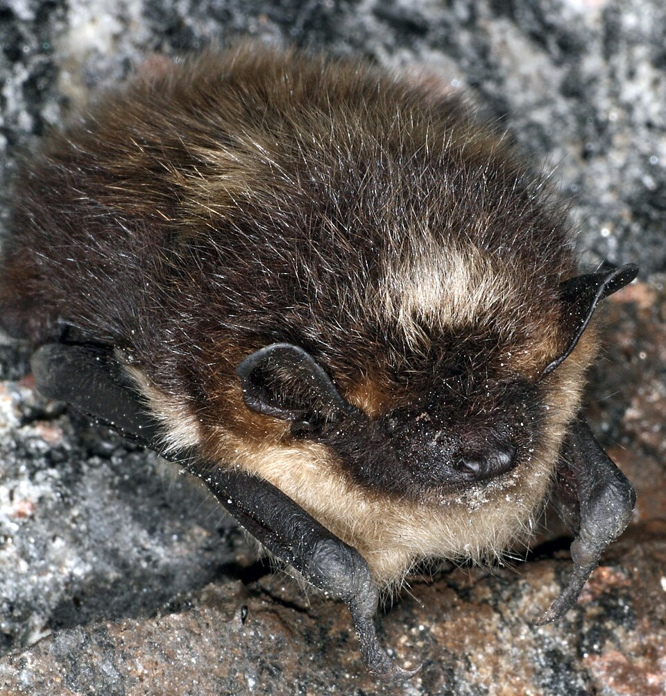
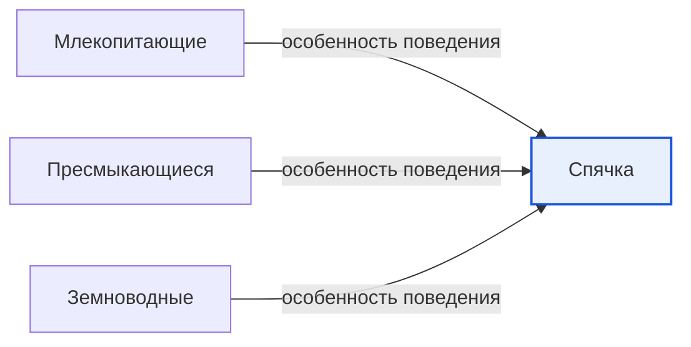

# Спячка

*Иллюстрация из Wikimedia Commons ([источник](https://commons.wikimedia.org/wiki/File:Eptesicus_nilssonii_hibernating.JPG)).*

<!-- body:start -->
Спячка - это особое состояние, в котором [животное](animals.md) проводит трудное время года, например зиму, когда холодно и нечего есть. Животное засыпает очень глубоким сном: его сердце бьётся медленно, дыхание становится редким, а тело остывает. Так оно тратит совсем мало сил и может дожить до весны. Учёные называют спячку ещё гибернацией.

## Зачем животным спячка

Зимой многим животным трудно. [Насекомые](insects.md) прячутся, трава уходит под снег, а чтобы согреться в мороз, нужно много энергии. Если еды нет, животное может погибнуть от [голода](../../neurobiology_for_teens/articles/08_hunger.md) и холода. Поэтому некоторые животные выбрали хитрый способ: просто «выключиться» на зиму и переждать.

Осенью они много едят и накапливают под кожей жир. Этот жир - как запас еды внутри тела. Во время спячки животное понемногу расходует его и не нуждается в пище.

## Кто впадает в спячку

**Настоящая спячка** бывает у некоторых [млекопитающих](mammals.md):

- **Ёж** осенью строит гнездо из листьев и засыпает. Температура его тела опускается почти до температуры [воздуха](../../../1.1_ustroystvo_mira/zemlya_priroda_i_klimat/articles/atmosphere.md) в укрытии, а сердце бьётся в несколько раз реже обычного.
- **Сурки** спят в норах целой семьёй больше половины года.
- **Летучие мыши** зимуют в пещерах и на чердаках, повиснув вниз головой. На картинке в начале статьи - северный кожанок во время спячки.

**Зимний сон** - это более лёгкое состояние. Так зимует бурый медведь. Он залегает в берлогу, спит и ничего не ест, но температура его тела опускается совсем немного. Медведя можно разбудить, а медведица даже рожает зимой в берлоге медвежат.

**Оцепенение** бывает у холоднокровных животных - [пресмыкающихся](reptiles.md) и [земноводных](amphibians.md). Когда становится холодно, их тело само остывает, и они замирают. Лягушки зарываются в ил на дне пруда, ящерицы и змеи прячутся под корнями и камнями. Весной солнце согревает их, и они просыпаются.

## Летняя спячка

Бывает, что животные засыпают не зимой, а летом, когда наступает сильная жара и засуха. Это называется летней спячкой. Так переживают засуху некоторые черепахи, улитки и даже [рыбы](fish.md): африканская двоякодышащая рыба зарывается в высохший ил и ждёт дождей.

## Почему спящих животных нельзя будить

Если разбудить животное посреди спячки, оно потратит на пробуждение очень много энергии - почти как за несколько недель сна. После этого запасов жира может не хватить до весны. Поэтому, если ты нашёл зимой спящего ежа или летучую мышь, не трогай их и сообщи взрослым или специалистам по защите животных.

## Интересные факты

1. Летом сердце ежа стучит почти двести раз в минуту, а во время спячки - всего около двадцати.
2. Лесной сурок перед спячкой набирает так много жира, что заметно толстеет.
3. За зиму медведь может похудеть почти на треть своего веса.
4. Некоторые летучие мыши могут проспать больше полугода.

## Проверь себя

1. Зачем животные перед спячкой накапливают жир?
2. Чем зимний сон медведя отличается от спячки ежа?
3. Почему спящее животное нельзя будить?
<!-- body:end -->

## Как это связано с другими понятиями

## Смотри также

- [Млекопитающие](mammals.md): млекопитающие → особенность поведения → спячка
- [Пресмыкающиеся](reptiles.md): пресмыкающиеся → особенность поведения → спячка
- [Земноводные](amphibians.md): земноводные → особенность поведения → спячка
- [Все статьи раздела «Животный мир»](../index.md)

## Источники

- WikiData: [Q159408](https://www.wikidata.org/wiki/Q159408)
- Википедия: [спячка](https://ru.wikipedia.org/wiki/%D0%A1%D0%BF%D1%8F%D1%87%D0%BA%D0%B0)

---
Автор: Дудовцев Андрей  
*Использованные нейросети: Claude (Anthropic), модель claude-opus-5-5 - генерация текстов статей.*
