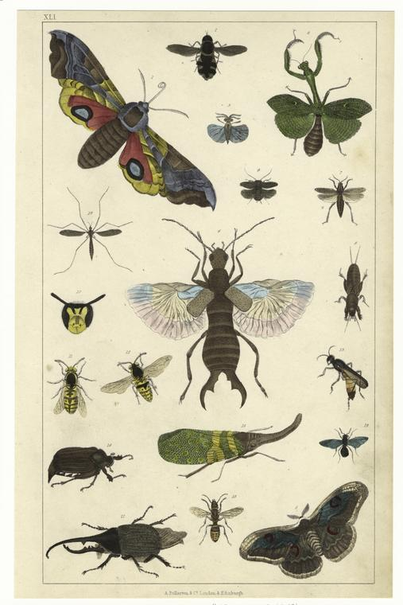
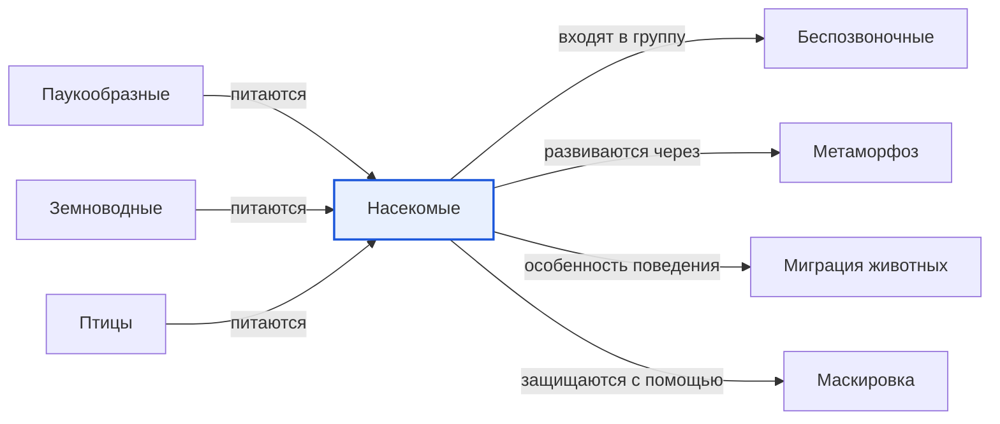

# Насекомые

*Иллюстрация из Wikimedia Commons ([источник](https://commons.wikimedia.org/wiki/File:Insekter.jpg)).*

<!-- body:start -->
Насекомые - это маленькие [беспозвоночные животные](invertebrates.md) с шестью ногами и телом из трёх частей. Жуки, бабочки, муравьи, пчёлы, мухи и кузнечики - все насекомые. Их больше, чем любых других [животных](animals.md) на планете: учёные описали уже около миллиона видов насекомых.

## Как устроено насекомое

Если посмотреть на насекомое через лупу, видно, что его тело делится на три части:

- **Голова.** На ней глаза, рот и усики. Усики помогают насекомому нюхать и ощупывать мир вокруг. Глаза у многих насекомых сложные: они состоят из сотен маленьких глазков.
- **Грудь.** К ней прикреплены шесть ног и, у многих видов, крылья - одна или две пары.
- **Брюшко.** Здесь находятся органы, которые переваривают пищу.

Снаружи тело насекомого покрыто твёрдым панцирем - экзоскелетом. Это как доспехи, только живые. [Скелета](vertebrates.md) внутри, как у нас, у насекомых нет.

## Как насекомые растут

Многие насекомые за свою жизнь превращаются из одного существа в совсем другое. Это называется метаморфозом. Из яйца бабочки выходит гусеница, гусеница превращается в [куколку](metamorphosis.md), а из куколки появляется бабочка. У кузнечика всё проще: из яйца выходит маленький кузнечик без крыльев, который много раз линяет и постепенно становится взрослым.

## Главные отряды насекомых

Учёные делят насекомых на отряды. По данным WikiData, самые известные из них:

- **Жесткокрылые** - жуки. У них передние крылья твёрдые и защищают задние, как футляр. Божья коровка - тоже жук.
- **Чешуекрылые** - бабочки. Их крылья покрыты крошечными чешуйками, которые остаются на пальцах, если тронуть бабочку.
- **Перепончатокрылые** - пчёлы, осы и муравьи. Многие из них живут большими семьями.
- **Двукрылые** - мухи и комары.
- **Прямокрылые** - кузнечики и сверчки.

## Зачем нужны насекомые

Насекомые очень важны для природы. Пчёлы, шмели и бабочки переносят пыльцу с цветка на цветок, и благодаря этому у [растений](../../../1.1_ustroystvo_mira/zemlya_priroda_i_klimat/articles/ecosystem.md) появляются плоды и семена. Божьи коровки поедают тлю, которая вредит [растениям](../../why_science_help_understand_world/nature.md). А сами насекомые - главная еда для многих [птиц](birds.md), [земноводных](amphibians.md), [паукообразных](arachnids.md) и [рыб](fish.md).

Чтобы спастись от врагов, насекомые используют [маскировку](camouflage.md): палочник выглядит как сухая веточка, а некоторые бабочки складывают крылья и становятся похожи на листок. А бабочка-монарх совершает настоящую [миграцию](migration.md): осенью миллионы монархов летят на юг, в Мексику.

## Интересные факты

1. Муравей может поднять предмет в несколько раз тяжелее собственного тела.
2. Медоносные пчёлы рассказывают друг другу, где цветы, с помощью особого танца.
3. Стрекоза умеет летать вперёд, назад и зависать на месте, как вертолёт.
4. Самые древние насекомые жили на Земле задолго до динозавров.

## Проверь себя

1. Из каких трёх частей состоит тело насекомого?
2. Сколько ног у насекомого?
3. Как насекомые помогают [растениям](../../why_science_help_understand_world/life_sciences.md)?
<!-- body:end -->

## Как это связано с другими понятиями

## Смотри также

- [Беспозвоночные](invertebrates.md): насекомые → входят в группу → беспозвоночные
- [Паукообразные](arachnids.md): паукообразные → питаются → насекомые
- [Земноводные](amphibians.md): земноводные → питаются → насекомые
- [Птицы](birds.md): птицы → питаются → насекомые
- [Метаморфоз](metamorphosis.md): насекомые → развиваются через → метаморфоз
- [Миграция животных](migration.md): насекомые → особенность поведения → миграция животных
- [Маскировка](camouflage.md): насекомые → защищаются с помощью → маскировка
- [Все статьи раздела «Животный мир»](../index.md)

## Источники

- WikiData: [Q1390](https://www.wikidata.org/wiki/Q1390)
- Википедия: [насекомые](https://ru.wikipedia.org/wiki/%D0%9D%D0%B0%D1%81%D0%B5%D0%BA%D0%BE%D0%BC%D1%8B%D0%B5)

---
Автор: Цыбулько Даниил  
*Использованные нейросети: Claude (Anthropic), модель claude-opus-5-5 - генерация текстов статей.*
