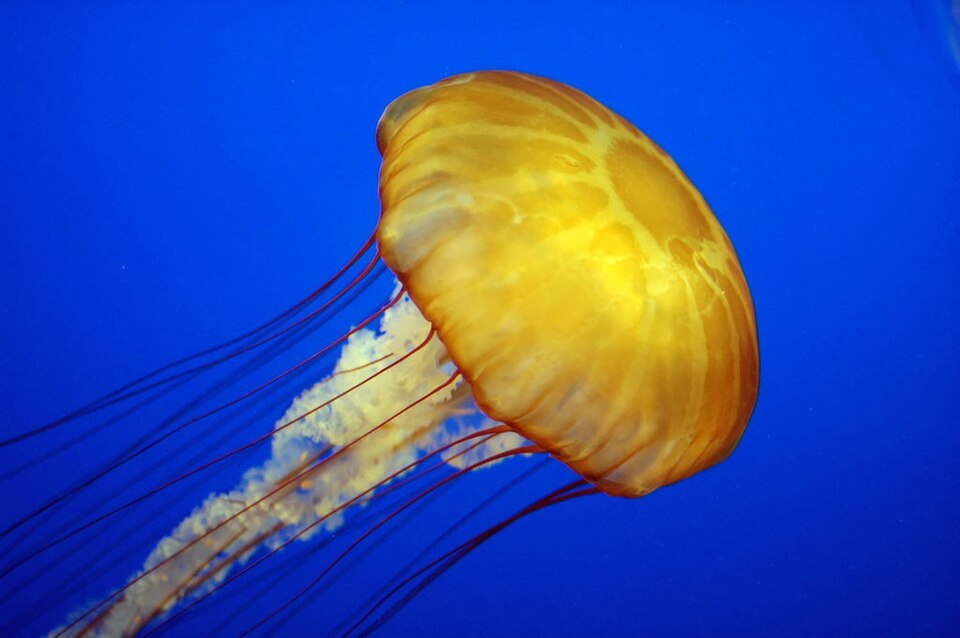
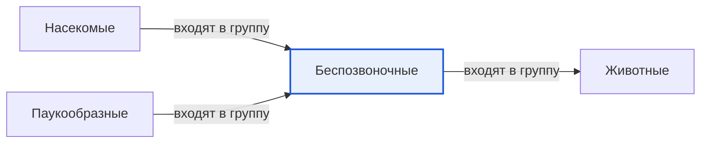

# Беспозвоночные

*Иллюстрация из Wikimedia Commons ([источник](https://commons.wikimedia.org/wiki/File:Jelly_cc11.jpg)).*

<!-- body:start -->
Беспозвоночные - это [животные](animals.md), у которых нет [позвоночника](vertebrates.md). Дождевой червь, улитка, медуза, осьминог, [бабочка](insects.md) и [паук](arachnids.md) - все они беспозвоночные. Это самая большая часть животного мира: больше девяти из каждых десяти видов животных на Земле не имеют позвоночника.

## Как живут без позвоночника

Позвоночник служит опорой для тела. Но беспозвоночные прекрасно обходятся без него, и у них есть свои способы держать форму.

- **Мягкое тело.** У червей, медуз и слизней тело мягкое. Медузе в воде опора почти не нужна: вода сама поддерживает её.
- **Раковина.** Улитки и многие моллюски носят на себе твёрдую раковину, как переносной домик. В случае опасности они прячутся внутрь.
- **Панцирь снаружи.** У насекомых, пауков и раков скелет находится не внутри, а снаружи. Он называется экзоскелетом и работает как рыцарские доспехи. Когда животное растёт, ему приходится сбрасывать старый панцирь и ждать, пока затвердеет новый. Это называется линькой.

## Главные группы беспозвоночных

По данным WikiData, среди беспозвоночных есть несколько больших групп:

- **Членистоногие** - у них тело и ноги разделены на членики. Сюда входят насекомые, паукообразные и ракообразные. Это самая многочисленная группа животных на планете.
- **Моллюски** - улитки, слизни, мидии, кальмары и осьминоги. Многие из них носят раковину.
- **Кольчатые черви** - их тело состоит из множества колечек. Самый известный пример - дождевой червь.
- **Стрекающие** - медузы, кораллы и актинии. У них есть стрекательные клетки, которые жалят [добычу](predators.md).
- **Иглокожие** - морские звёзды и морские ежи.

## Зачем природе беспозвоночные

Беспозвоночные очень важны. Дождевые черви рыхлят землю и помогают [растениям](../../../1.1_ustroystvo_mira/zemlya_priroda_i_klimat/articles/ecosystem.md) расти. Пчёлы и бабочки опыляют цветы. Многие насекомые - главная еда для [птиц](birds.md), [лягушек](amphibians.md) и [рыб](fish.md), поэтому без беспозвоночных распалась бы вся [пищевая цепь](food_chain.md). А кораллы строят огромные рифы, где живут тысячи видов морских животных.

## Интересные факты

1. Осьминог - один из самых умных беспозвоночных: он умеет открывать банки и находить выход из лабиринта.
2. У осьминога три сердца и голубая кровь.
3. Дождевой червь дышит всей поверхностью кожи, и после сильного дождя часто выползает наружу: учёные считают, что одна из причин - земля пропитывается водой.
4. Морская звезда, потерявшая луч, может отрастить новый.

## Проверь себя

1. Какие три способа держать форму тела есть у беспозвоночных?
2. Что такое экзоскелет и почему животному приходится линять?
3. Почему без беспозвоночных было бы плохо другим животным?
<!-- body:end -->

## Как это связано с другими понятиями

## Смотри также

- [Животные](animals.md): беспозвоночные → входят в группу → животные
- [Насекомые](insects.md): насекомые → входят в группу → беспозвоночные
- [Паукообразные](arachnids.md): паукообразные → входят в группу → беспозвоночные
- [Все статьи раздела «Животный мир»](../index.md)

## Источники

- WikiData: [Q43806](https://www.wikidata.org/wiki/Q43806)
- Википедия: [беспозвоночные](https://ru.wikipedia.org/wiki/%D0%91%D0%B5%D1%81%D0%BF%D0%BE%D0%B7%D0%B2%D0%BE%D0%BD%D0%BE%D1%87%D0%BD%D1%8B%D0%B5)

---
Автор: Бойцов Иван  
*Использованные нейросети: Claude (Anthropic), модель claude-opus-5-5 - генерация текстов статей.*
