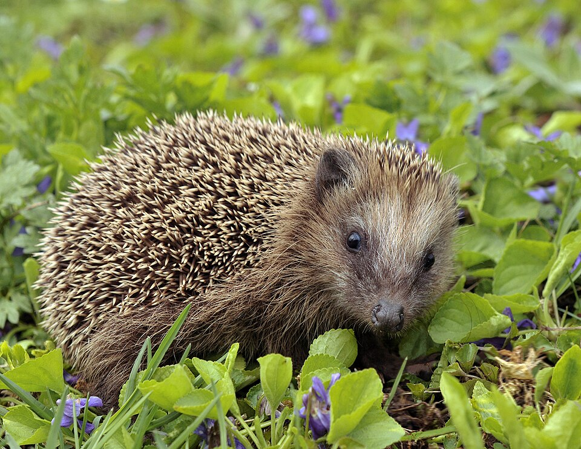
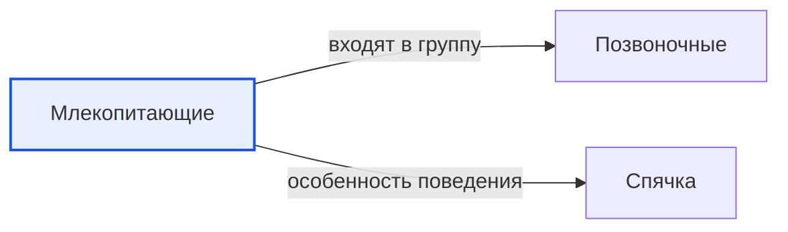

# Млекопитающие

*Иллюстрация из Wikimedia Commons, на снимке: обыкновенный ёж ([источник](https://commons.wikimedia.org/wiki/File:Erinaceus_europaeus_%28Linnaeus%2C_1758%29.jpg)).*

<!-- body:start -->
Млекопитающие - это [животные](animals.md), которые выкармливают своих детёнышей молоком. Отсюда и название: «млеко» - старое слово, означающее «молоко». Кошка, собака, корова, ёж, кит, летучая мышь и человек - все мы млекопитающие.

## Главные признаки млекопитающих

Как узнать млекопитающее? У него есть несколько особенных черт:

- **Молоко для детёнышей.** У мамы есть молочные железы, и первые недели или месяцы жизни малыш питается только молоком.
- **Шерсть или волосы.** Почти у всех млекопитающих есть шерсть. Она греет, как тёплая шуба. Даже у кита при рождении есть несколько волосков.
- **Теплокровность.** Тело млекопитающего само поддерживает одинаковую температуру и в жару, и в мороз. Поэтому млекопитающие могут жить и в [Арктике](../../../1.1_ustroystvo_mira/zemlya_priroda_i_klimat/articles/natural_zones.md), и в [пустыне](../../../1.1_ustroystvo_mira/zemlya_priroda_i_klimat/articles/desert.md).
- **Забота о потомстве.** Родители долго кормят, греют и учат своих детёнышей. Котёнок учится охотиться, играя с мамой, а медвежонок два-три года ходит за медведицей.
- **Большой мозг.** Млекопитающие хорошо учатся и запоминают.

Почти все млекопитающие рождают живых детёнышей. Но есть удивительное исключение - утконос. Он откладывает яйца, а когда детёныши вылупляются, кормит их молоком.

## На какие группы делятся млекопитающие

Учёные делят млекопитающих на отряды. Вот некоторые из них:

- **Хищные** - волки, кошки, медведи, тюлени. Многие из них охотятся на других животных.
- **Рукокрылые** - летучие мыши. Это единственные млекопитающие, которые по-настоящему летают.
- **Грызуны** - мыши, белки, бобры. Их зубы растут всю жизнь, поэтому им нужно постоянно грызть.
- **Китообразные** - киты и дельфины. Они живут в воде, но дышат [воздухом](../../../1.1_ustroystvo_mira/zemlya_priroda_i_klimat/articles/atmosphere.md).
- **Насекомоядные** - ежи и кроты, которые охотятся на [насекомых](insects.md) и [червей](invertebrates.md).
- **Однопроходные** - утконос и ехидна, те самые млекопитающие, которые откладывают яйца.

## Как млекопитающие переживают трудности

Млекопитающие живут почти в любой [среде обитания](habitat.md). Чтобы пережить холодную зиму, когда мало еды, ёж и сурок впадают в [спячку](hibernation.md), а медведь засыпает в берлоге. Среди млекопитающих есть и [хищники](predators.md), и [травоядные](herbivores.md), и [всеядные животные](omnivores.md).

## Интересные факты

1. Синий кит - самое большое животное, которое когда-либо жило на Земле. Одно его сердце весит больше, чем два взрослых человека.
2. Самое маленькое млекопитающее - карликовая белозубка: она весит меньше двух граммов.
3. Летучие мыши находят дорогу в темноте с помощью звука: они кричат и слушают эхо.
4. Детёныш синего кита каждый день прибавляет в весе почти сто килограммов, питаясь маминым молоком.

## Проверь себя

1. Почему млекопитающие так называются?
2. Какое млекопитающее откладывает яйца?
3. Какие млекопитающие умеют по-настоящему летать?
<!-- body:end -->

## Как это связано с другими понятиями

## Смотри также

- [Позвоночные](vertebrates.md): млекопитающие → входят в группу → позвоночные
- [Спячка](hibernation.md): млекопитающие → особенность поведения → спячка
- [Все статьи раздела «Животный мир»](../index.md)

## Источники

- WikiData: [Q7377](https://www.wikidata.org/wiki/Q7377)
- Википедия: [млекопитающие](https://ru.wikipedia.org/wiki/%D0%9C%D0%BB%D0%B5%D0%BA%D0%BE%D0%BF%D0%B8%D1%82%D0%B0%D1%8E%D1%89%D0%B8%D0%B5)

---
Автор: Бойцов Иван  
*Использованные нейросети: Claude (Anthropic), модель claude-opus-5-5 - генерация текстов статей.*
