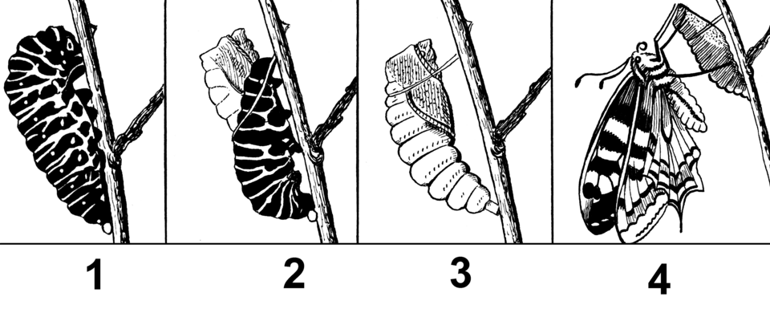
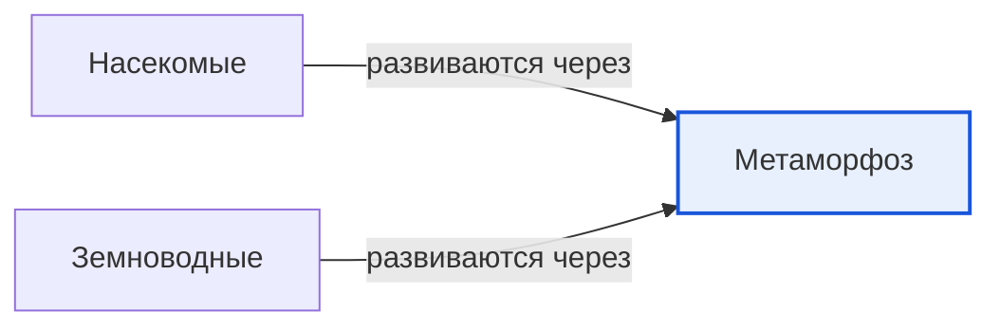

# Метаморфоз

*Иллюстрация из Wikimedia Commons ([источник](https://commons.wikimedia.org/wiki/File:Metamorphosis_of_butterfly_%28PSF%29.png)).*

<!-- body:start -->
Метаморфоз - это превращение, при котором [животное](animals.md) за свою жизнь меняется так сильно, что становится совсем на себя не похожим. [Гусеница](insects.md) превращается в бабочку, а [головастик](amphibians.md) - в лягушку. Детёныш и взрослый при этом выглядят как два разных животных, живут по-разному и даже едят разную еду.

## Превращение бабочки

Посмотри на картинку в начале статьи: на ней показана вся жизнь бабочки. Её превращение проходит четыре этапа:

1. **Яйцо.** Бабочка откладывает крошечные яйца на листья [растения](../../../1.1_ustroystvo_mira/zemlya_priroda_i_klimat/articles/ecosystem.md), которые потом будут есть её детёныши.
2. **Гусеница.** Из яйца выходит гусеница - это личинка бабочки. Она почти всё время ест листья и очень быстро растёт. Её кожа не растягивается, поэтому гусеница несколько раз сбрасывает её, то есть линяет.
3. **Куколка.** Когда гусеница вырастает, она перестаёт есть и превращается в куколку. Снаружи кажется, что куколка просто неподвижно висит. Но внутри идёт огромная работа: тело гусеницы перестраивается в тело бабочки.
4. **Бабочка.** Наконец оболочка куколки лопается, и из неё выбирается бабочка. Она расправляет и сушит крылья и улетает. Взрослая бабочка пьёт нектар цветов хоботком.

Такое превращение с куколкой называется **полным превращением**. Оно есть у бабочек, жуков, мух, пчёл и муравьёв.

## Неполное превращение

У некоторых насекомых, например у кузнечиков, тараканов и стрекоз, стадии куколки нет. Из яйца выходит личинка, которая уже немного похожа на взрослое насекомое, только без крыльев. Она растёт, несколько раз линяет и постепенно становится взрослой. Это называется **неполным превращением**.

## Превращение лягушки

Метаморфоз бывает не только у насекомых, но и у земноводных:

1. Лягушка откладывает в воду икру.
2. Из икринок выходят **головастики**. У них есть хвост и [жабры](fish.md), они живут только в воде и едят водоросли.
3. Постепенно у головастика вырастают задние, а потом передние лапы.
4. Хвост становится всё короче, жабры исчезают, вместо них развиваются лёгкие.
5. Маленький лягушонок выходит на сушу и начинает охотиться на насекомых.

## Зачем нужен метаморфоз

Учёные считают, что метаморфоз очень выгоден. Детёныши и взрослые едят разную пищу и живут в разных местах, поэтому не соперничают друг с другом за еду. Гусеница ест листья, а бабочка - нектар. Головастик живёт в воде, а взрослая лягушка - в основном на суше.

## Интересные факты

1. Гусеница за время роста может увеличить свой вес в сотни и даже тысячи раз.
2. Личинки стрекоз живут под водой иногда несколько лет, а взрослыми стрекозами - всего несколько недель или месяцев.
3. Мексиканская амбистома, аксолотль, - необычное земноводное: она часто так и не проходит метаморфоз и всю жизнь остаётся похожей на большого головастика.
4. Бабочка-монарх, которая выходит из куколки осенью, может прожить несколько месяцев и совершить далёкую [миграцию](migration.md).

## Проверь себя

1. Назови четыре этапа полного превращения бабочки.
2. Чем неполное превращение отличается от полного?
3. Как меняется головастик, когда превращается в лягушку?
<!-- body:end -->

## Как это связано с другими понятиями

## Смотри также

- [Насекомые](insects.md): насекомые → развиваются через → метаморфоз
- [Земноводные](amphibians.md): земноводные → развиваются через → метаморфоз
- [Все статьи раздела «Животный мир»](../index.md)

## Источники

- WikiData: [Q33753](https://www.wikidata.org/wiki/Q33753)
- Википедия: [метаморфоз](https://ru.wikipedia.org/wiki/%D0%9C%D0%B5%D1%82%D0%B0%D0%BC%D0%BE%D1%80%D1%84%D0%BE%D0%B7)

---
Автор: Дудовцев Андрей  
*Использованные нейросети: Claude (Anthropic), модель claude-opus-5-5 - генерация текстов статей.*
