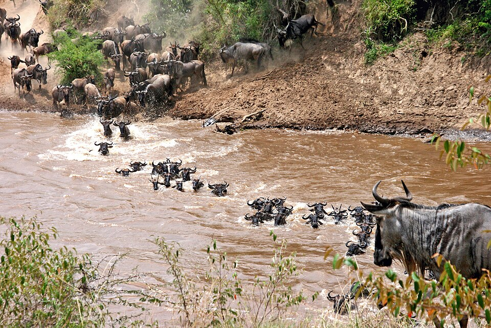
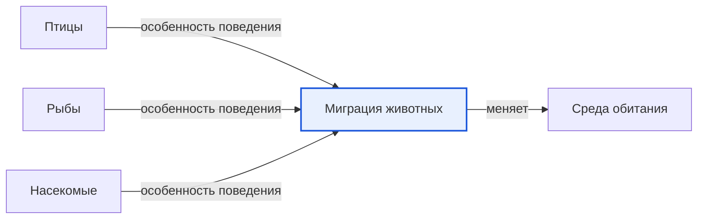

# Миграция животных

*Иллюстрация из Wikimedia Commons ([источник](https://commons.wikimedia.org/wiki/File:Connochaetes_taurinus_-Wildebeest_crossing_river_-East_Africa.jpg)).*

<!-- body:start -->
Миграция [животных](animals.md) - это далёкие путешествия, которые животные совершают регулярно, чаще всего каждый год, из одного места в другое и обратно. Осенью журавли улетают на юг, а весной возвращаются. Киты плывут через [океан](../../../1.1_ustroystvo_mira/zemlya_priroda_i_klimat/articles/water_cycle.md), а [рыбы](fish.md) поднимаются вверх по рекам. Всё это миграции.

## Зачем животные отправляются в путь

Животные мигрируют не ради приключений. Обычно у них есть важная причина:

- **Найти еду.** Зимой на севере выпадает снег, замерзают реки, пропадают [насекомые](insects.md). [Птицам](birds.md), которые ими питаются, становится нечего есть, и они улетают туда, где тепло и еды много.
- **Вывести потомство.** Многие животные ищут для детёнышей самое безопасное место. Лососи плывут на нерест в спокойные реки, а киты уплывают рожать детёнышей в тёплые воды.
- **Спастись от холода или засухи.** В африканской [саванне](../../../1.1_ustroystvo_mira/zemlya_priroda_i_klimat/articles/natural_zones.md) в сухой сезон высыхает трава, и огромные стада антилоп гну и зебр уходят туда, где прошли дожди. На картинке в начале статьи гну переходят реку во время такой миграции.

Получается, что во время миграции животное меняет [среду обитания](habitat.md): зиму проводит в одном месте, лето - в другом.

## Знаменитые путешественники

- **Птицы.** Белый аист и серый журавль каждый год улетают из Европы зимовать в Африку. Полярная крачка - рекордсмен: она летит из Арктики в Антарктику и обратно.
- **Рыбы.** Атлантический лосось рождается в реке, уплывает расти в море, а через несколько лет возвращается именно в ту реку, где появился на свет, чтобы отложить икру.
- **[Млекопитающие](mammals.md).** Горбатый кит летом кормится в холодных морях, а зимой уплывает в тёплые воды, где рождаются китята. [Северные олени](../../../1.1_ustroystvo_mira/zemlya_priroda_i_klimat/articles/tundra.md) кочуют по [тундре](../../../1.1_ustroystvo_mira/zemlya_priroda_i_klimat/articles/climate.md) в поисках корма.
- **Насекомые.** Бабочка-монарх, такая лёгкая и хрупкая, пролетает тысячи километров из Канады и США в горы Мексики. Обратный путь проделывают уже их дети и внуки.

## Как животные находят дорогу

Как же птица, у которой нет ни карты, ни телефона, находит путь за тысячи километров? Учёные выяснили, что у животных есть несколько «навигаторов»:

- **Солнце и звёзды.** Многие птицы ориентируются по солнцу днём и по звёздам ночью.
- **Магнитное поле Земли.** Птицы, [черепахи](reptiles.md) и лососи чувствуют его, словно у них внутри компас.
- **Запахи.** Лосось находит родную реку по её особому запаху.
- **Приметы.** Птицы запоминают горы, реки и берега морей, над которыми пролетают.

## Опасности в пути

Миграция - очень трудное и опасное дело. Животные устают, голодают, попадают в бури. Мешают им и люди: плотины перегораживают реки лососям, а яркий свет городов сбивает с пути ночных птиц. Поэтому учёные стараются защищать места, где путешественники отдыхают и кормятся.

## Интересные факты

1. Полярная крачка за жизнь может пролететь расстояние, сравнимое с несколькими полётами до Луны и обратно.
2. Перед перелётом многие птицы сильно толстеют: жир - это топливо для долгой дороги.
3. Учёные следят за путешествиями животных с помощью маленьких датчиков и колец, которые надевают на лапки птиц.
4. Некоторые птицы во время перелёта над морем летят без остановки несколько суток.

## Проверь себя

1. Назови три причины, по которым животные мигрируют.
2. Как лосось находит родную реку?
3. Какие «навигаторы» помогают птицам не сбиться с пути?
<!-- body:end -->

## Как это связано с другими понятиями

## Смотри также

- [Птицы](birds.md): птицы → особенность поведения → миграция животных
- [Рыбы](fish.md): рыбы → особенность поведения → миграция животных
- [Насекомые](insects.md): насекомые → особенность поведения → миграция животных
- [Среда обитания](habitat.md): миграция животных → меняет → среда обитания
- [Все статьи раздела «Животный мир»](../index.md)

## Источники

- WikiData: [Q193145](https://www.wikidata.org/wiki/Q193145)
- Википедия: [миграция животных](https://ru.wikipedia.org/wiki/%D0%9C%D0%B8%D0%B3%D1%80%D0%B0%D1%86%D0%B8%D1%8F_%D0%B6%D0%B8%D0%B2%D0%BE%D1%82%D0%BD%D1%8B%D1%85)

---
Автор: Дудовцев Андрей  
*Использованные нейросети: Claude (Anthropic), модель claude-opus-5-5 - генерация текстов статей.*
