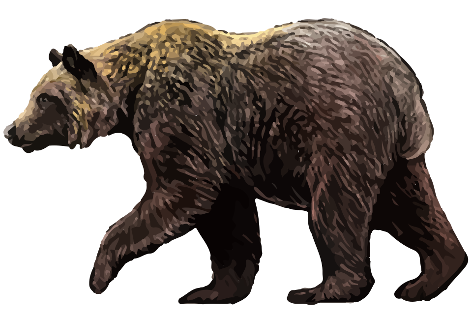
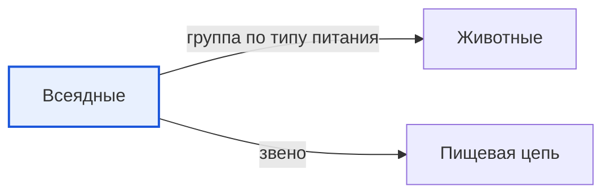

# Всеядные

*Иллюстрация из Wikimedia Commons, на снимке: бурый медведь ([источник](https://commons.wikimedia.org/wiki/File:202309_Ezo_brown_bear.svg)).*

<!-- body:start -->
Всеядные - это [животные](animals.md), которые едят и [растения](../../../1.1_ustroystvo_mira/zemlya_priroda_i_klimat/articles/ecosystem.md), и животных. Бурый медведь, кабан, ёж, ворона и енот - всеядные. Человек, кстати, тоже всеядный: мы едим и кашу с овощами, и мясо с [рыбой](fish.md).

## Что едят всеядные

Меню всеядного животного зависит от того, что удалось найти:

- **Бурый медведь** весной ищет молодую траву и корни, летом объедается ягодами, ловит рыбу и раскапывает муравейники, а осенью ест орехи и жёлуди. Иногда медведь охотится и на крупных животных.
- **Кабан** роет землю мощным рылом и находит там корни, грибы, [жуков](insects.md), [червей](invertebrates.md) и [личинок](metamorphosis.md).
- **Ёж** охотится на жуков, гусениц, слизней и дождевых червей, а может съесть и упавшее яблоко или ягоду.
- **Серая ворона** клюёт зёрна и фрукты, ловит мышей и насекомых и не упустит остатки чужого обеда.

## Почему всеядным легче выжить

У всеядности есть большой плюс. Если исчезнет одна еда, всеядное животное переключится на другую. Например, если в лесу не уродились ягоды, медведь поищет рыбу или насекомых. [Хищнику](predators.md) без добычи или [травоядному](herbivores.md) без травы пришлось бы гораздо труднее.

Поэтому всеядные животные хорошо приспосабливаются к разным условиям. Вороны, крысы и еноты отлично живут рядом с людьми, даже в больших городах: там всегда можно найти что-нибудь съедобное. Их [среда обитания](habitat.md) может быть очень разной - от леса до городского двора.

## Как устроены всеядные

Зубы у всеядных похожи и на зубы хищников, и на зубы травоядных. У медведя есть острые клыки, чтобы рвать мясо, и плоские зубы, чтобы перетирать [растения](../../why_science_help_understand_world/nature.md). У человека тоже есть и острые резцы, и широкие коренные зубы.

## Всеядные в пищевой цепи

В [пищевой цепи](food_chain.md) всеядные могут стоять сразу в нескольких местах. Когда медведь ест ягоды, он ведёт себя как травоядное. Когда ловит рыбу - как хищник. Поэтому всеядные связывают между собой разные звенья цепи и делают природу прочнее.

К осени многие всеядные, например медведь и ёж, усиленно едят и накапливают жир. Этот запас помогает им пережить зиму во время [спячки](hibernation.md) или зимнего сна.

## Интересные факты

1. Медведь может съесть за день десятки тысяч ягод, когда готовится к зиме.
2. Вороны и их родственники очень умные. Некоторые из них умеют пользоваться палочками, чтобы доставать еду из щелей.
3. Кабаны отлично находят еду по запаху и могут учуять жёлуди и корни глубоко под землёй.
4. Ежи едят много насекомых-вредителей, поэтому садоводы рады, когда ёж поселяется у них в саду.

## Проверь себя

1. Почему всеядным животным легче найти еду?
2. Какие зубы бывают у всеядных?
3. Почему про всеядных говорят, что они могут стоять в пищевой цепи сразу в нескольких местах?
<!-- body:end -->

## Как это связано с другими понятиями

## Смотри также

- [Животные](animals.md): всеядные → группа по типу питания → животные
- [Пищевая цепь](food_chain.md): всеядные → звено → пищевая цепь
- [Все статьи раздела «Животный мир»](../index.md)

## Источники

- WikiData: [Q30898693](https://www.wikidata.org/wiki/Q30898693)
- Википедия: [всеядность](https://ru.wikipedia.org/wiki/%D0%92%D1%81%D0%B5%D1%8F%D0%B4%D0%BD%D0%BE%D1%81%D1%82%D1%8C)

---
Автор: Цыбулько Даниил  
*Использованные нейросети: Claude (Anthropic), модель claude-opus-5-5 - генерация текстов статей.*
