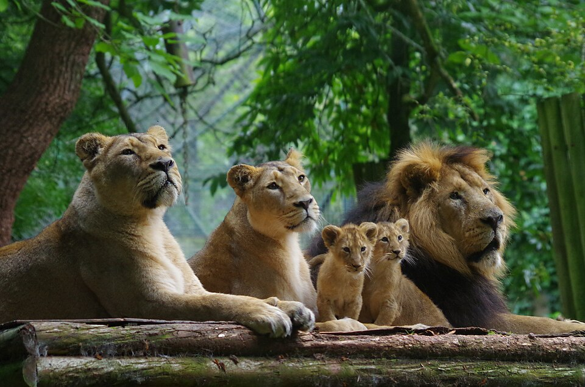
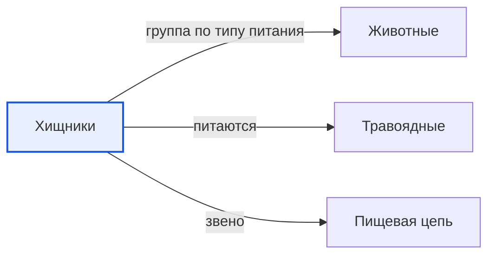

# Хищники

*Иллюстрация из Wikimedia Commons, на снимке: лев ([источник](https://commons.wikimedia.org/wiki/File:PZ_lion_pride.jpg)).*

<!-- body:start -->
Хищники - это [животные](animals.md), которые охотятся на других животных и питаются их мясом. Учёные называют их ещё плотоядными, то есть «мясоедами». Волк, лев, тигр, лиса, сова и щука - все они хищники.

## Как устроены охотники

Чтобы поймать добычу, хищнику нужны особые «инструменты». Природа выдала их каждому охотнику по-своему:

- **Острые зубы и клыки.** У волка и тигра длинные клыки, чтобы схватить и удержать добычу, и острые зубы, чтобы резать мясо, как ножницами.
- **Когти.** Кошки прячут когти в мягкие подушечки на лапах и выпускают их только во время охоты, поэтому когти не тупятся. А у орлов и сов на лапах мощные изогнутые когти, которыми они крепко держат добычу.
- **Зоркие глаза.** Глаза у многих хищников смотрят вперёд. Так им легче точно определить, как далеко находится добыча. Сова видит в темноте, а орёл замечает мышь с огромной высоты.
- **Острый нюх и слух.** Волк чует запах добычи издалека, иногда больше чем за километр, а лиса слышит, как под снегом шуршит мышь.

## Как хищники охотятся

У каждого хищника своя хитрость:

- **Засада.** Тигр подкрадывается тихо-тихо, прячась в траве, а потом делает быстрый бросок. Его полосатая окраска помогает ему оставаться незаметным - это настоящая [маскировка](camouflage.md).
- **Погоня.** Гепард - самый быстрый бегун на суше. Он догоняет антилопу на коротком рывке.
- **Охота стаей.** Волки и львы охотятся вместе. Одни гонят добычу, другие ждут в засаде. Так стая может поймать даже большого лося.
- **Ловушки.** [Паук](arachnids.md) плетёт паутину и ждёт, пока в неё попадёт муха.

## Зачем природе хищники

Может показаться, что хищники просто злые. Но это не так. Хищники охотятся, потому что иначе не могут добыть еду - так устроено их тело. И они очень нужны природе.

Хищники чаще всего ловят больных, старых или слабых животных. Поэтому стада [травоядных](herbivores.md) остаются здоровыми и сильными. А ещё хищники не дают травоядным расплодиться слишком сильно и съесть все [растения](../../../1.1_ustroystvo_mira/zemlya_priroda_i_klimat/articles/ecosystem.md). Без волков олени и зайцы объели бы молодые деревья, и лес начал бы погибать. Так хищники становятся важным [звеном](food_chain.md) пищевой цепи.

Хищники бывают среди самых разных животных: среди [млекопитающих](mammals.md), [птиц](birds.md), [рыб](fish.md), [пресмыкающихся](reptiles.md) и даже [насекомых](insects.md), например божья коровка ест тлю.

## Интересные факты

1. Лев - единственная кошка, которая живёт большими семьями, они называются прайдами. Охотятся в прайде чаще всего львицы.
2. Хамелеон ловит насекомых языком, который может быть длиннее его собственного тела.
3. Гепард на коротком рывке разгоняется примерно до 100 километров в час - как машина на загородной дороге.
4. Только примерно одна охота из нескольких у хищников заканчивается удачно, поэтому им приходится много стараться.

## Проверь себя

1. Почему у многих хищников глаза смотрят вперёд?
2. Какие способы охоты ты запомнил?
3. Почему хищники полезны для природы?
<!-- body:end -->

## Как это связано с другими понятиями

## Смотри также

- [Животные](animals.md): хищники → группа по типу питания → животные
- [Травоядные](herbivores.md): хищники → питаются → травоядные
- [Пищевая цепь](food_chain.md): хищники → звено → пищевая цепь
- [Все статьи раздела «Животный мир»](../index.md)

## Источники

- WikiData: [Q81875](https://www.wikidata.org/wiki/Q81875)
- Википедия: [плотоядные](https://ru.wikipedia.org/wiki/%D0%9F%D0%BB%D0%BE%D1%82%D0%BE%D1%8F%D0%B4%D0%BD%D1%8B%D0%B5)

---
Автор: Цыбулько Даниил  
*Использованные нейросети: Claude (Anthropic), модель claude-opus-5-5 - генерация текстов статей.*
