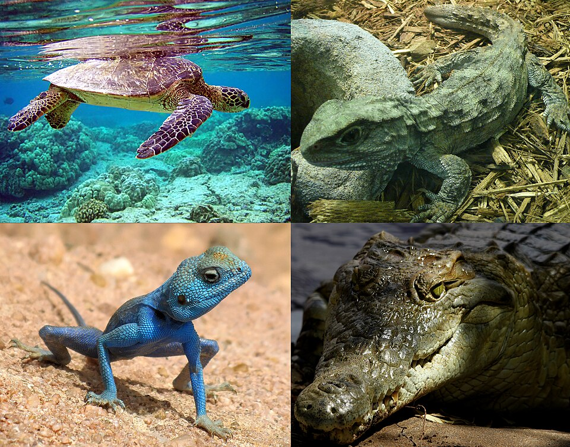
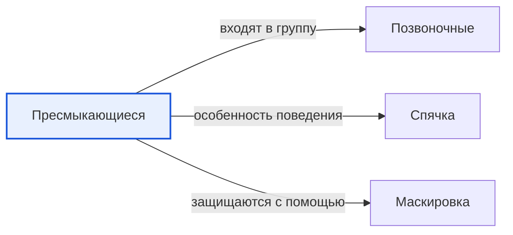

# Пресмыкающиеся

*Иллюстрация из Wikimedia Commons ([источник](https://commons.wikimedia.org/wiki/File:Extant_reptilia.jpg)).*

<!-- body:start -->
Пресмыкающиеся, или рептилии, - это [позвоночные животные](vertebrates.md) с сухой кожей, покрытой чешуёй или щитками. Ящерицы, змеи, черепахи и крокодилы - всё это пресмыкающиеся. Название появилось потому, что многие из них ползают, прижимаясь к земле, то есть «пресмыкаются».

## Чешуя и холодная кровь

Кожа рептилии сухая и покрыта роговыми чешуйками. Такая «броня» не даёт телу пересыхать, поэтому рептилии хорошо живут даже в [жарких пустынях](../../../1.1_ustroystvo_mira/zemlya_priroda_i_klimat/articles/desert.md). Когда [животное](animals.md) растёт, оно линяет: змея, например, сбрасывает старую кожу целиком, как чулок.

Рептилии холоднокровные. Это значит, что их тело не умеет само себя согревать, как у кошки или человека. Утром ящерица выползает на камень и греется на солнце, чтобы набраться сил. Когда становится слишком жарко, она прячется в тень или в норку. А в холодные месяцы многие рептилии впадают в [оцепенение](hibernation.md) - зимнюю спячку - и почти не двигаются до весны.

## Яйца на суше

Большинство рептилий откладывают яйца на суше. У яйца плотная кожистая или известковая скорлупа, которая защищает малыша от высыхания. Поэтому, в отличие от [земноводных](amphibians.md), рептилиям не нужно возвращаться в воду, чтобы вывести потомство. Детёныши вылупляются уже похожими на взрослых, только маленькими. Есть и исключения: например, обыкновенная гадюка рождает живых детёнышей.

## Четыре группы рептилий

Учёные выделяют четыре группы современных пресмыкающихся:

- **Чешуйчатые** - ящерицы и змеи. Это самая большая группа. К ней относится прыткая ящерица, которую можно встретить на лесной опушке, и обыкновенная гадюка.
- **Черепахи** - у них есть панцирь, в который можно спрятать голову и лапы. Зелёная морская черепаха проплывает огромные расстояния по [океану](../../../1.1_ustroystvo_mira/zemlya_priroda_i_klimat/articles/water_cycle.md).
- **Крокодилы** - большие [хищники](predators.md), живущие у воды. Нильский крокодил - один из самых крупных.
- **Клювоголовые** - очень редкая группа. Сейчас в ней только один вид, гаттерия, который живёт в Новой Зеландии.

Многие рептилии умеют прятаться: их окраска сливается с песком, корой или листьями. Это называется [маскировкой](camouflage.md). Особенно знаменит хамелеон, который может менять цвет кожи.

## Интересные факты

1. [Птицы](birds.md) - ближайшие родственники крокодилов среди ныне живущих животных.
2. Некоторые черепахи живут больше ста лет.
3. Змеи не слышат звуки так, как мы, но хорошо чувствуют дрожание земли.
4. Гаттерию называют живым ископаемым: её родственники жили ещё во времена динозавров.

## Проверь себя

1. Почему рептилии греются на солнце?
2. Чем яйцо рептилии помогает ей жить вдали от воды?
3. Назови четыре группы современных пресмыкающихся.
<!-- body:end -->

## Как это связано с другими понятиями

## Смотри также

- [Позвоночные](vertebrates.md): пресмыкающиеся → входят в группу → позвоночные
- [Спячка](hibernation.md): пресмыкающиеся → особенность поведения → спячка
- [Маскировка](camouflage.md): пресмыкающиеся → защищаются с помощью → маскировка
- [Все статьи раздела «Животный мир»](../index.md)

## Источники

- WikiData: [Q10811](https://www.wikidata.org/wiki/Q10811)
- Википедия: [пресмыкающиеся](https://ru.wikipedia.org/wiki/%D0%9F%D1%80%D0%B5%D1%81%D0%BC%D1%8B%D0%BA%D0%B0%D1%8E%D1%89%D0%B8%D0%B5%D1%81%D1%8F)

---
Автор: Бойцов Иван  
*Использованные нейросети: Claude (Anthropic), модель claude-opus-5-5 - генерация текстов статей.*
