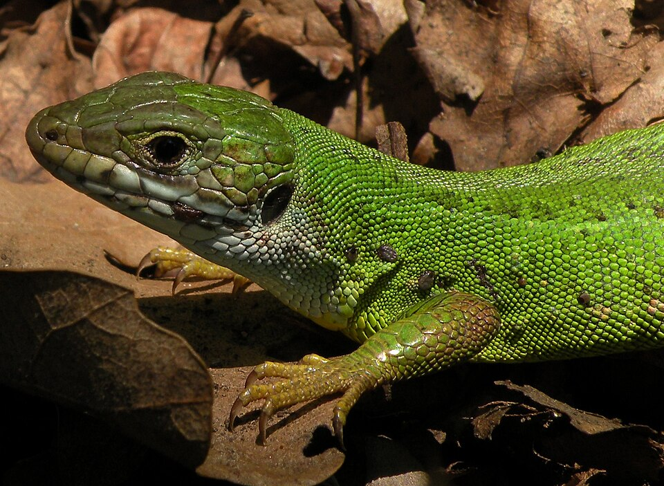
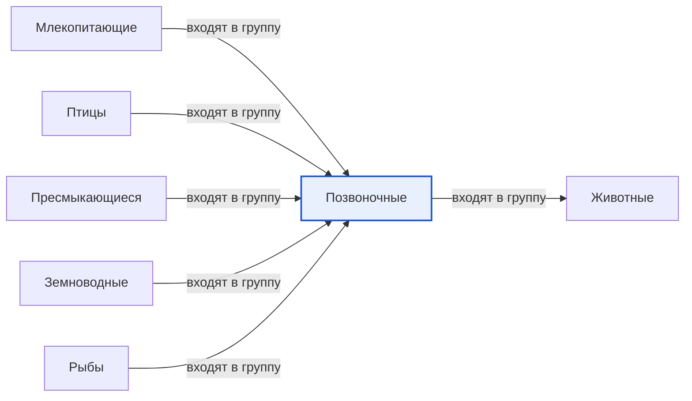

# Позвоночные

*Иллюстрация из Wikimedia Commons ([источник](https://commons.wikimedia.org/wiki/File:Lizard_on_leaf_cutted.jpg)).*

<!-- body:start -->
Позвоночные - это [животные](animals.md), у которых внутри тела есть скелет, а вдоль спины проходит позвоночник. Собака, воробей, [ящерица](reptiles.md), [лягушка](amphibians.md), щука и ты сам - все позвоночные. Позвоночник служит телу прочной опорой, как стержень, на котором всё держится.

## Что такое позвоночник и зачем он нужен

Позвоночник складывается из маленьких косточек - позвонков. Они соединены между собой, как бусины на нитке, поэтому спина может гнуться в разные стороны. Внутри позвонков, как в защитной трубке, проходит [спинной мозг](../../neurobiology_for_teens/articles/03_nervous_system_map.md). По нему бегут сигналы от головного мозга ко всему телу: «подними лапу», «махни хвостом», «беги».

Скелет у позвоночных находится внутри тела. Он растёт вместе с животным, поэтому позвоночные могут вырастать очень большими. Именно среди них есть самые крупные животные на Земле - киты, слоны, жирафы.

## Пять больших групп позвоночных

Учёные делят позвоночных на несколько групп. Самые известные из них - пять:

- **[Рыбы](fish.md)** живут в воде и дышат жабрами. Например, щука, карась, акула.
- **Земноводные** рождаются в воде, а взрослыми могут жить и на суше. Это лягушки, жабы, тритоны.
- **Пресмыкающиеся**, или рептилии, покрыты сухой чешуёй и откладывают яйца на суше: ящерицы, змеи, черепахи, крокодилы.
- **[Птицы](birds.md)** покрыты перьями, у них есть крылья и клюв, а детёныши вылупляются из яиц.
- **[Млекопитающие](mammals.md)** выкармливают детёнышей молоком, и у большинства из них есть шерсть. К ним относятся кошки, собаки, лошади и люди.

Рыбы, земноводные и пресмыкающиеся - холоднокровные: температура их тела зависит от того, тепло или холодно вокруг. Птицы и млекопитающие - теплокровные: их тело само держит постоянную температуру, даже в мороз.

## Чем позвоночные отличаются от беспозвоночных

У [беспозвоночных животных](invertebrates.md) позвоночника нет. Их тело либо мягкое, как у червя или медузы, либо защищено твёрдым панцирем снаружи, как у [жука](insects.md) или рака. Позвоночных видов на Земле гораздо меньше, чем беспозвоночных: их около семидесяти тысяч, а одних только насекомых больше миллиона. Зато позвоночные обычно крупнее и лучше всех умеют быстро бегать, летать и плавать.

## Интересные факты

1. У жирафа такая длинная шея, но шейных позвонков у него столько же, сколько у человека и у мыши, - семь. Просто каждый позвонок очень длинный.
2. У змеи может быть несколько сотен позвонков, поэтому она так легко изгибается.
3. Самые первые позвоночные на Земле были похожи на маленьких рыб без челюстей.
4. Самое большое позвоночное и вообще самое большое животное - синий кит.

## Проверь себя

1. Из чего состоит позвоночник и что проходит у него внутри?
2. Назови пять больших групп позвоночных.
3. Какие позвоночные теплокровные, а какие холоднокровные?
<!-- body:end -->

## Как это связано с другими понятиями

## Смотри также

- [Животные](animals.md): позвоночные → входят в группу → животные
- [Млекопитающие](mammals.md): млекопитающие → входят в группу → позвоночные
- [Птицы](birds.md): птицы → входят в группу → позвоночные
- [Пресмыкающиеся](reptiles.md): пресмыкающиеся → входят в группу → позвоночные
- [Земноводные](amphibians.md): земноводные → входят в группу → позвоночные
- [Рыбы](fish.md): рыбы → входят в группу → позвоночные
- [Все статьи раздела «Животный мир»](../index.md)

## Источники

- WikiData: [Q25241](https://www.wikidata.org/wiki/Q25241)
- Википедия: [позвоночные](https://ru.wikipedia.org/wiki/%D0%9F%D0%BE%D0%B7%D0%B2%D0%BE%D0%BD%D0%BE%D1%87%D0%BD%D1%8B%D0%B5)

---
Автор: Бойцов Иван  
*Использованные нейросети: Claude (Anthropic), модель claude-opus-5-5 - генерация текстов статей.*
