# Животный мир

Раздел детской энциклопедии KidBook о том, как устроены и как живут животные. Здесь можно узнать, на какие группы учёные делят животных, кто кого ест в природе, зачем птицы улетают на юг, как гусеница становится бабочкой и почему некоторые виды нуждаются в нашей защите.

Раздел относится к теме **1.2 Естественные науки в жизни**.

## Карта понятий

Сплошные стрелки показывают, какая группа входит в какую. Пунктирные стрелки показывают другие связи: кто кого ест, кто где живёт, кто как защищается.

```mermaid
graph TD
    subgraph b0["Кто такие животные"]
        animals["Животные"]
        vertebrates["Позвоночные"]
        invertebrates["Беспозвоночные"]
    end
    subgraph b1["Позвоночные животные"]
        mammals["Млекопитающие"]
        birds["Птицы"]
        reptiles["Пресмыкающиеся"]
        amphibians["Земноводные"]
        fish["Рыбы"]
    end
    subgraph b2["Беспозвоночные животные"]
        insects["Насекомые"]
        arachnids["Паукообразные"]
    end
    subgraph b3["Кто чем питается"]
        predators["Хищники"]
        herbivores["Травоядные"]
        omnivores["Всеядные"]
        foodchain["Пищевая цепь"]
    end
    subgraph b4["Как животные живут"]
        habitat["Среда обитания"]
        migration["Миграция животных"]
        hibernation["Спячка"]
        metamorphosis["Метаморфоз"]
        camouflage["Маскировка"]
        endangeredspecies["Вымирающие виды"]
    end
    vertebrates -->|входят в группу| animals
    invertebrates -->|входят в группу| animals
    mammals -->|входят в группу| vertebrates
    birds -->|входят в группу| vertebrates
    reptiles -->|входят в группу| vertebrates
    amphibians -->|входят в группу| vertebrates
    fish -->|входят в группу| vertebrates
    insects -->|входят в группу| invertebrates
    arachnids -->|входят в группу| invertebrates
    predators -.->|группа по типу питания| animals
    herbivores -.->|группа по типу питания| animals
    omnivores -.->|группа по типу питания| animals
    predators -.->|питаются| herbivores
    arachnids -.->|питаются| insects
    amphibians -.->|питаются| insects
    birds -.->|питаются| insects
    herbivores -.->|звено| foodchain
    predators -.->|звено| foodchain
    omnivores -.->|звено| foodchain
    animals -.->|живут в| habitat
    foodchain -.->|зависит от| habitat
    insects -.->|развиваются через| metamorphosis
    amphibians -.->|развиваются через| metamorphosis
    birds -.->|особенность поведения| migration
    fish -.->|особенность поведения| migration
    insects -.->|особенность поведения| migration
    mammals -.->|особенность поведения| hibernation
    reptiles -.->|особенность поведения| hibernation
    amphibians -.->|особенность поведения| hibernation
    insects -.->|защищаются с помощью| camouflage
    reptiles -.->|защищаются с помощью| camouflage
    amphibians -.->|защищаются с помощью| camouflage
    migration -.->|меняет| habitat
    habitat -.->|разрушение ведёт к| endangeredspecies
```

## Статьи

### Кто такие животные

- [Животные](articles/animals.md) - Что отличает животных от растений и грибов, как учёные делят животных на группы и почему животные двигаются, дышат и питаются готовой пищей.
- [Позвоночные](articles/vertebrates.md) - О животных с внутренним скелетом и позвоночником: какие группы к ним относятся, зачем нужен позвоночник и чем позвоночные отличаются от беспозвоночных.
- [Беспозвоночные](articles/invertebrates.md) - О животных без позвоночника: черви, моллюски, медузы, насекомые и пауки, их панцири и раковины, и почему беспозвоночных на Земле больше всего.

### Позвоночные животные

- [Млекопитающие](articles/mammals.md) - О теплокровных животных, которые выкармливают детёнышей молоком: шерсть, забота о потомстве, главные отряды млекопитающих и необычные представители вроде кита и летучей мыши.
- [Птицы](articles/birds.md) - О птицах: перья, полые кости и крылья, как птицы летают, строят гнёзда, высиживают яйца и почему птиц считают потомками динозавров.
- [Пресмыкающиеся](articles/reptiles.md) - О пресмыкающихся (рептилиях): чешуя, холоднокровность, яйца с кожистой скорлупой, ящерицы, змеи, черепахи и крокодилы.
- [Земноводные](articles/amphibians.md) - О земноводных (амфибиях), которые живут и в воде, и на суше: лягушки, жабы, тритоны и саламандры, влажная кожа и превращение головастика во взрослое животное.
- [Рыбы](articles/fish.md) - О рыбах: жабры, плавники, чешуя и плавательный пузырь, как рыбы дышат под водой, где живут и чем акула отличается от карася.

### Беспозвоночные животные

- [Насекомые](articles/insects.md) - О насекомых: шесть ног, три части тела, усики и крылья, жуки, бабочки, муравьи и пчёлы, и почему без насекомых не было бы многих растений.
- [Паукообразные](articles/arachnids.md) - О паукообразных: восемь ног, паутина и яд, пауки, клещи и скорпионы, чем паук отличается от насекомого и какую пользу приносят пауки.

### Кто чем питается

- [Хищники](articles/predators.md) - О хищных (плотоядных) животных, которые охотятся на других животных: клыки и когти, способы охоты и почему хищники нужны природе.
- [Травоядные](articles/herbivores.md) - О растительноядных животных: как они переваривают траву и листья, зачем корове несколько отделов желудка и как травоядные спасаются от хищников.
- [Всеядные](articles/omnivores.md) - О всеядных животных, которые едят и растения, и животных: медведи, кабаны, вороны, ежи, и почему всеядность помогает выжить.
- [Пищевая цепь](articles/food_chain.md) - О том, кто кого ест в природе: растения, травоядные и хищники как звенья пищевой цепи, пищевые сети и что происходит, если одно звено пропадает.

### Как животные живут

- [Среда обитания](articles/habitat.md) - О местах, где живут животные: лес, степь, пустыня, океан, тундра и город, и как животные приспосабливаются к жаре, холоду и воде.
- [Миграция животных](articles/migration.md) - О дальних путешествиях животных: перелётные птицы, лососи, киты и бабочки-монархи, зачем животные мигрируют и как находят дорогу.
- [Спячка](articles/hibernation.md) - О том, как животные переживают зиму и нехватку еды: зимняя спячка ежа и сурка, зимний сон медведя, оцепенение лягушек и ящериц.
- [Метаморфоз](articles/metamorphosis.md) - О превращениях животных: яйцо, гусеница, куколка и бабочка, головастик и лягушка, полное и неполное превращение.
- [Маскировка](articles/camouflage.md) - О защитной окраске и маскировке: хамелеон, палочник, белый заяц зимой, мимикрия и как окраска помогает и прятаться, и охотиться.
- [Вымирающие виды](articles/endangered_species.md) - О животных, которым грозит исчезновение: почему виды вымирают, что такое Красная книга, заповедники и как каждый может помочь природе.

## Словарь

Краткие определения всех понятий раздела собраны в [словаре терминов](glossary.md).

---
Авторы: Бойцов Иван, Цыбулько Даниил, Дудовцев Андрей  
*Использованные нейросети: Claude (Anthropic), модель claude-opus-5-5 - генерация текстов статей.*
