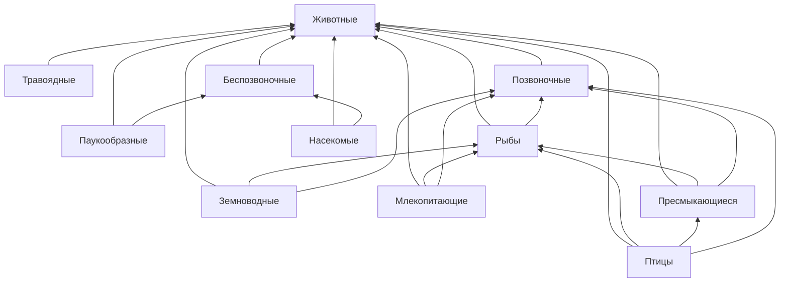

# KidBook: Животный мир

Лабораторная работа по курсу «Искусственный интеллект». Раздел детской энциклопедии KidBook о том, как устроены и как живут животные.

| | |
|:---|:---|
| Раздел | 1. Мир и наука |
| Подраздел | 1.2 Естественные науки в жизни |
| Тема | Животный мир: как устроены и как живут животные |
| Участники | Бойцов Иван, Цыбулько Даниил, Дудовцев Андрей |
| Понятий и статей | 20 |
| Готовые статьи | [WEB/1.2_natural_sciences/animal_world](../../../WEB/1.2_natural_sciences/animal_world/index.md) |

## Цель работы

Сделать раздел детской энциклопедии с помощью двух подходов:

- **явное представление знаний**: извлечь факты о животных из WikiData SPARQL-запросами и построить собственную онтологию предметной области;
- **генеративные модели**: написать статьи по каждому понятию большой языковой моделью (Claude) с промптом «объясни для десятилетнего ребёнка», подставляя в промпт факты из WikiData и связи из онтологии.

## Почему эта тема

В списке примерных тем к подразделу 1.2 есть «Биология: как устроена живая природа», и её никто не взял. В репозитории не было ни одной статьи о животных, хотя для десятилетнего читателя это одна из самых интересных тем. К тому же животный мир очень хорошо описан в WikiData: у таксонов есть иерархия «родительский таксон» (P171), латинские названия (P225), охранные статусы МСОП (P141) и фотографии (P18). Это позволило по-настоящему использовать граф знаний, а не только сослаться на него.

По требованию задания на каждого участника нужно не меньше трёх понятий (для трёх человек это 9). В разделе 20 понятий.

## Распределение работы

| Участник | Этап работы | Понятия (автор статей) |
|:---|:---|:---|
| Бойцов Иван | извлечение знаний из WikiData (SPARQL), концептуализация и онтология | Животные, Позвоночные, Беспозвоночные, Млекопитающие, Птицы, Пресмыкающиеся, Земноводные, Рыбы |
| Цыбулько Даниил | генерация текстов через LLM, промпты, проверка фактов | Насекомые, Паукообразные, Хищники, Травоядные, Всеядные, Пищевая цепь |
| Дудовцев Андрей | сборка статей, перекрёстные ссылки с учётом падежей, `concepts.json`, отчёт | Среда обитания, Миграция животных, Спячка, Метаморфоз, Маскировка, Вымирающие виды |

Автор каждого понятия указан в `data/ontology.json` (поле `author`), оттуда он попадает в подпись статьи и в `concepts.json`.

## Структура папки

```
WORK/1.2_natural_sciences/animal_world/
├── README.md                 этот отчёт
├── concepts.json             список понятий в формате репозитория (генерируется)
├── requirements.txt          зависимости Python
├── .env.example              шаблон файла с ключом Claude API
├── data/
│   ├── ontology.json         концептуализация: понятия, блоки, типизированные связи (написана вручную)
│   ├── wikidata_facts.json   факты из WikiData по каждому понятию (генерируется)
│   ├── wikidata_graph.json   подграф связей между понятиями в WikiData (генерируется)
│   ├── image_sources.json    какой файл Wikimedia Commons скачан для какого понятия
│   └── generated/*.md        тексты статей, написанные языковой моделью
├── sparql/*.rq               SPARQL-запросы к WikiData
└── scripts/
    ├── common.py             общие пути и функции
    ├── fetch_wikidata.py     шаг 1: извлечение знаний и картинок из WikiData
    ├── generate_articles.py  шаг 2: генерация текстов через Claude API
    ├── build_articles.py     шаг 3: сборка статей, страницы раздела, словаря, concepts.json
    └── cross_link.py         шаг 4: перекрёстные ссылки с учётом падежей

WEB/1.2_natural_sciences/animal_world/
├── index.md                  страница раздела с картой понятий
├── glossary.md               словарь терминов раздела
├── articles/*.md             20 статей
└── images/                   20 иллюстраций из Wikimedia Commons
```

## Концептуализация

Предметная область разбита на пять смысловых блоков. Первые три описывают, **кто** такие животные (классификация), два последних описывают, **как** они живут (питание, поведение, охрана).

| Блок | Понятия | WikiData |
|:---|:---|:---|
| Кто такие животные | Животные, Позвоночные, Беспозвоночные | Q729, Q25241, Q43806 |
| Позвоночные животные | Млекопитающие, Птицы, Пресмыкающиеся, Земноводные, Рыбы | Q7377, Q5113, Q10811, Q10908, Q152 |
| Беспозвоночные животные | Насекомые, Паукообразные | Q1390, Q1358 |
| Кто чем питается | Хищники, Травоядные, Всеядные, Пищевая цепь | Q81875, Q59099, Q30898693, Q159462 |
| Как животные живут | Среда обитания, Миграция животных, Спячка, Метаморфоз, Маскировка, Вымирающие виды | Q52105, Q193145, Q159408, Q33753, Q196327, Q11394 |

Концептуализация хранится в [data/ontology.json](data/ontology.json). Это единственный файл, который пишется вручную. Из него автоматически строятся `concepts.json`, диаграммы, блоки «Смотри также» в статьях, страница раздела и словарь.

### Онтология

Между понятиями 34 связи 11 типов. Иерархическая связь только одна (`subclass_of`, «входят в группу»). Остальные 10 типов горизонтальные: они связывают классификацию животных с их питанием, поведением и средой обитания.

| Тип связи | Подпись | Вид | Кол-во | Пример |
|:---|:---|:---|:---:|:---|
| subclass_of | входят в группу | иерархия | 9 | Птицы → Позвоночные |
| feeding_group_of | группа по типу питания | классификация | 3 | Хищники → Животные |
| eats | питаются | горизонтальная | 4 | Паукообразные → Насекомые |
| link_of | звено | часть - целое | 3 | Травоядные → Пищевая цепь |
| lives_in | живут в | горизонтальная | 1 | Животные → Среда обитания |
| depends_on | зависит от | горизонтальная | 1 | Пищевая цепь → Среда обитания |
| develops_by | развиваются через | процесс | 2 | Насекомые → Метаморфоз |
| behavior | особенность поведения | свойство | 6 | Птицы → Миграция животных |
| protects_by | защищаются с помощью | свойство | 3 | Пресмыкающиеся → Маскировка |
| changes | меняет | горизонтальная | 1 | Миграция животных → Среда обитания |
| leads_to | разрушение ведёт к | причина - следствие | 1 | Среда обитания → Вымирающие виды |

Сплошные стрелки на схеме обозначают иерархию, пунктирные - все остальные связи.

```mermaid
graph TD
    subgraph b0["Кто такие животные"]
        animals["Животные"]
        vertebrates["Позвоночные"]
        invertebrates["Беспозвоночные"]
    end
    subgraph b1["Позвоночные животные"]
        mammals["Млекопитающие"]
        birds["Птицы"]
        reptiles["Пресмыкающиеся"]
        amphibians["Земноводные"]
        fish["Рыбы"]
    end
    subgraph b2["Беспозвоночные животные"]
        insects["Насекомые"]
        arachnids["Паукообразные"]
    end
    subgraph b3["Кто чем питается"]
        predators["Хищники"]
        herbivores["Травоядные"]
        omnivores["Всеядные"]
        foodchain["Пищевая цепь"]
    end
    subgraph b4["Как животные живут"]
        habitat["Среда обитания"]
        migration["Миграция животных"]
        hibernation["Спячка"]
        metamorphosis["Метаморфоз"]
        camouflage["Маскировка"]
        endangeredspecies["Вымирающие виды"]
    end
    vertebrates -->|входят в группу| animals
    invertebrates -->|входят в группу| animals
    mammals -->|входят в группу| vertebrates
    birds -->|входят в группу| vertebrates
    reptiles -->|входят в группу| vertebrates
    amphibians -->|входят в группу| vertebrates
    fish -->|входят в группу| vertebrates
    insects -->|входят в группу| invertebrates
    arachnids -->|входят в группу| invertebrates
    predators -.->|группа по типу питания| animals
    herbivores -.->|группа по типу питания| animals
    omnivores -.->|группа по типу питания| animals
    predators -.->|питаются| herbivores
    arachnids -.->|питаются| insects
    amphibians -.->|питаются| insects
    birds -.->|питаются| insects
    herbivores -.->|звено| foodchain
    predators -.->|звено| foodchain
    omnivores -.->|звено| foodchain
    animals -.->|живут в| habitat
    foodchain -.->|зависит от| habitat
    insects -.->|развиваются через| metamorphosis
    amphibians -.->|развиваются через| metamorphosis
    birds -.->|особенность поведения| migration
    fish -.->|особенность поведения| migration
    insects -.->|особенность поведения| migration
    mammals -.->|особенность поведения| hibernation
    reptiles -.->|особенность поведения| hibernation
    amphibians -.->|особенность поведения| hibernation
    insects -.->|защищаются с помощью| camouflage
    reptiles -.->|защищаются с помощью| camouflage
    amphibians -.->|защищаются с помощью| camouflage
    migration -.->|меняет| habitat
    habitat -.->|разрушение ведёт к| endangeredspecies
```

<!-- ontology:start -->

<!-- ontology:end -->

## Извлечение знаний из WikiData

Скрипт [scripts/fetch_wikidata.py](scripts/fetch_wikidata.py) выполняет SPARQL-запросы из папки [sparql/](sparql/) к публичному сервису `query.wikidata.org` и сохраняет результат в [data/wikidata_facts.json](data/wikidata_facts.json).

| Запрос | Что извлекается |
|:---|:---|
| [01_concept_facts.rq](sparql/01_concept_facts.rq) | русское и английское название, описание, синонимы, латинское название (P225), картинка (P18), статья в русской Википедии |
| [02_parents.rq](sparql/02_parents.rq) | родительские понятия: родительский таксон (P171), подкласс (P279), экземпляр (P31) |
| [03_orders_under_taxon.rq](sparql/03_orders_under_taxon.rq) | отряды (P105 = Q36602) внутри класса, отсортированные по известности (число статей в Википедиях) |
| [04_taxa_by_latin_name.rq](sparql/04_taxa_by_latin_name.rq) | 76 животных-примеров по латинскому названию: русское название, описание, охранный статус МСОП (P141), фото |
| [05_endangered_species.rq](sparql/05_endangered_species.rq) | самые известные виды со статусом «вымирающий» (Q11394) и «на грани исчезновения» (Q219127) |
| [06_is_animal.rq](sparql/06_is_animal.rq) | ASK-проверка, что вид относится к царству животных (чтобы отсеять растения) |
| [07_concept_graph.rq](sparql/07_concept_graph.rq) | подграф: какие понятия раздела связаны в WikiData цепочками P171 или P279 |

Пример запроса - отряды насекомых:

```sparql
SELECT DISTINCT ?order ?label ?sitelinks WHERE {
  { ?order wdt:P171 wd:Q1390 }
  UNION { ?order wdt:P171/wdt:P171 wd:Q1390 }
  # ... и так до глубины 8
  ?order wdt:P105 wd:Q36602 ;
         wikibase:sitelinks ?sitelinks ;
         rdfs:label ?label .
  FILTER(lang(?label) = "ru" && REGEX(?label, "^[а-яё]"))
}
ORDER BY DESC(?sitelinks) LIMIT 8
```

Что получилось (фрагмент [data/wikidata_facts.json](data/wikidata_facts.json)):

| Понятие | Подгруппы из WikiData |
|:---|:---|
| Млекопитающие | рукокрылые, хищные, однопроходные, сирены, двурезцовые сумчатые, копытные |
| Птицы | совообразные, курообразные, гусеобразные, ржанкообразные, пеликанообразные, ястребообразные |
| Насекомые | чешуекрылые, жесткокрылые, двукрылые, богомоловые, таракановые, перепончатокрылые |
| Паукообразные | пауки, скорпионы, сенокосцы, сольпуги, ложноскорпионы, фрины |
| Земноводные | бесхвостые, хвостатые, безногие земноводные |
| Пресмыкающиеся | чешуйчатые, черепахи, крокодилы, клювоголовые |
| Беспозвоночные | членистоногие, моллюски, кольчатые черви, стрекающие, иглокожие |
| Вымирающие виды | какапо, чёрный носорог, речной угорь, мексиканская амбистома, гангский гавиал, яванский носорог, европейская норка |

Как знания из WikiData использованы дальше:

- факты, подгруппы, примеры животных и их охранные статусы подставляются в промпт к языковой модели, поэтому статьи опираются на проверяемые данные (например, статус аксолотля и речного угря в статьях взят из WikiData);
- русские синонимы (`skos:altLabel`) добавлены в `lemmas` в `concepts.json` и помогают находить понятия в тексте;
- фотографии (P18) скачаны из Wikimedia Commons и стоят в начале каждой статьи с подписью и ссылкой на источник;
- в каждой статье есть ссылки на понятие в WikiData и на статью в Википедии.

### Подграф WikiData и его сравнение с онтологией

Запрос 07 нашёл 22 связи между понятиями раздела (по цепочкам P171 и P279, включая транзитивные). Схема ниже построена автоматически:

<!-- wikidata-graph:start -->

<!-- wikidata-graph:end -->

Это интересный результат: WikiData описывает животных по **кладистике**, то есть по родству. В ней птицы входят в группу пресмыкающихся (они потомки динозавров), а млекопитающие, птицы, пресмыкающиеся и земноводные лежат внутри «рыб», потому что произошли от древних рыб. С научной точки зрения это верно, но для десятилетнего ребёнка удобнее привычная школьная классификация из пяти классов позвоночных. Поэтому в онтологии раздела используются традиционные классы, а родство птиц с динозаврами и происхождение позвоночных от рыб рассказаны в текстах статей как интересные факты.

### Трудности при работе с WikiData

- **Таймауты.** Запрос с путём `wdt:P171+` («все потомки класса») для насекомых не укладывается в 60 секунд публичного сервиса. Пришлось развернуть путь в явные `UNION` глубиной до 8 шагов.
- **Кладистика у пресмыкающихся.** Отряды черепах, крокодилов и чешуйчатых не выводятся к классу Reptilia (Q10811) по цепочке P171, поэтому их QID перечислены явно и проверены по латинскому названию.
- **Ошибочные QID.** При ручном вводе идентификаторов два оказались чужими (вместо черепах попал Бутрос Бутрос-Гали, вместо кольчатых червей кряква). После этого все примеры ищутся по латинскому названию (P225), что однозначно.
- **Неподходящая картинка.** У понятия «плотоядные» (Q81875) картинкой в WikiData стоит росянка - хищное растение. Для статьи о хищных животных она заменена на фото львов (`IMAGE_OVERRIDE`).
- **Несколько значений.** У одного объекта бывает несколько картинок, и порядок строк в ответе меняется от запуска к запуску. Запросы используют `MIN()`, а соответствие «картинка - источник» сохраняется в `data/image_sources.json`.

## Генерация текстов

Скрипт [scripts/generate_articles.py](scripts/generate_articles.py) вызывает Claude API (модель `claude-opus-5-5`, официальный Python SDK `anthropic`). Для каждого понятия собирается промпт из трёх частей:

1. название понятия и о чём должна быть статья (из онтологии);
2. сведения из WikiData: описание, синонимы, научное название, подгруппы, животные-примеры с охранным статусом;
3. связанные понятия раздела из онтологии с типами связей - модель упоминает их в тексте, и потом на эти упоминания ставятся ссылки.

Системный промпт:

```text
Ты автор детской энциклопедии KidBook. Пишешь на русском языке для детей примерно десяти лет.

Правила:
- Объясняй просто, как объяснил бы десятилетнему ребёнку: короткие предложения, понятные слова,
  сравнения с тем, что ребёнок видит дома, во дворе, в школе.
- Каждый новый термин сразу объясняй простыми словами.
- Пиши только достоверные факты. Опирайся на сведения из WikiData, которые даны в запросе.
  Если не уверен в цифре, не называй её.
- Обращайся к читателю на «ты», тон дружелюбный, без сюсюканья.
- Никаких эмодзи и смайликов.
- Формат: GitHub Flavored Markdown. Не пиши заголовок первого уровня. Используй разделы ##.
- Объём: 350-550 слов.
```

Запрос к модели начинается со слов **«Объясни для десятилетнего ребёнка понятие ...»** и задаёт структуру статьи: вступление, 2-4 раздела, «Интересные факты», «Проверь себя». Полный промпт для любого понятия можно посмотреть без обращения к API:

```bash
.venv/bin/python scripts/generate_articles.py --print-prompt hibernation
```

Тексты, которые сейчас лежат в [data/generated/](data/generated/), написаны той же моделью Claude Opus 5.5 по тем же промптам в интерактивном режиме (Claude Code). Скрипт позволяет перегенерировать любую статью через API, когда будет ключ (см. «Как запустить»).

**Проверка фактов.** Все тексты вычитаны вручную. Спорные или слишком уверенные утверждения смягчены или исправлены, например:

- «сердце синего кита размером с автомобиль» заменено на проверяемое «весит больше, чем два взрослых человека»;
- «паутина крепче стали той же толщины» исправлено на «того же веса»;
- частота сердца ежа в спячке уточнена (около 20 ударов в минуту против почти 200 летом);
- в статье о хищниках убран повтор факта о скорости сапсана, который уже есть в статье о птицах.

## Сборка статей

[scripts/build_articles.py](scripts/build_articles.py) собирает каждую статью из нескольких частей:

1. заголовок и иллюстрация из Wikimedia Commons с подписью и ссылкой на источник;
2. текст модели между метками `<!-- body:start -->` и `<!-- body:end -->`;
3. диаграмма Mermaid «Как это связано с другими понятиями» - окрестность понятия в онтологии;
4. блок «Смотри также» со ссылками на связанные статьи и типом связи;
5. источники: ссылка на WikiData и на Википедию;
6. авторы и использованные нейросети (по правилам оформления статей).

Тот же скрипт строит страницу раздела [index.md](../../../WEB/1.2_natural_sciences/animal_world/index.md) с полной картой понятий, [словарь терминов](../../../WEB/1.2_natural_sciences/animal_world/glossary.md) и файл [concepts.json](concepts.json). В `concepts.json` кроме обязательных полей (`id`, `description`, `lemmas`, `name`, `file`, `wikidata_id`, `author`) есть поле `relations` с типизированными связями из онтологии.

## Перекрёстные ссылки и падежи

Задание требует расставлять ссылки так, чтобы они находились и во фразах вроде «дети без ума от **компьютерных игр**». Обычный поиск по строке так не умеет. [scripts/cross_link.py](scripts/cross_link.py) решает это морфологическим анализатором **pymorphy3**:

1. каждое ключевое слово из `lemmas` приводится к начальной форме пословно: «пищевая цепь» → `(пищевой, цепь)`;
2. каждое слово текста тоже приводится к начальной форме. Слово может разбираться неоднозначно («животных» - это и существительное «животное», и прилагательное «животный»), поэтому берутся все варианты разбора;
3. совпадением считается последовательность подряд идущих слов, у которых начальные формы совпали с ключом. Длинные ключи важнее коротких, свои понятия важнее чужих;
4. ссылка ставится только на первое упоминание понятия в статье и не ставится на саму себя.

Примеры найденных совпадений:

| В тексте | Ключевое слово | Ссылка на |
|:---|:---|:---|
| «образуют **пищевую цепь**» | пищевая цепь | Пищевая цепь |
| «называется **средой обитания**» | среда обитания | Среда обитания |
| «с помощью **маскировки**» | маскировка | Маскировка |
| «дышит **жабрами**» | жабры | Рыбы |
| «впадают в **оцепенение**» | оцепенение | Спячка |
| «**жарких пустынях**» | жаркие пустыни | Пустыня (раздел 1.1) |
| «**спинной мозг**» | спинной мозг | Карта нервной системы (раздел 1.2) |

**Ссылки на другие разделы.** Скрипт читает все `concepts.json` в репозитории. Чтобы не появлялись случайные ссылки, действуют фильтры:

- ссылка ставится только с существительного или прилагательного (иначе «внимательно» превращалось в ссылку на «Внимание», а «повторяют» - на «Повторение»);
- однословные ключи из стоп-листа слишком общие («учёный», «число», «город») и не используются;
- допускаются только тематически близкие разделы: устройство мира, естественные науки, здоровье и безопасность. До этого фильтра «морские звёзды» вели в астрономию, а «африканская» - в статью о банджо;
- не больше 4 внешних ссылок на статью.

Ссылки ставятся только внутри текста модели, поэтому заголовки, диаграммы и подписи не меняются. Повторный запуск ничего не добавляет: уже связанные понятия учитываются.

Итог: **167 ссылок внутри раздела и 50 ссылок на статьи других групп** (разделы 1.1 «Земля, природа и климат», 1.1 «Материя», 1.2 «Почему наука помогает понимать мир», 1.2 «Нейробиология для подростков»).

## Как запустить

Нужен Python 3.10 или новее.

```bash
cd WORK/1.2_natural_sciences/animal_world
python3 -m venv .venv
.venv/bin/pip install -r requirements.txt

# ключ Claude API (нужен только для шага 2)
cp .env.example .env        # и вставить ключ в .env

.venv/bin/python scripts/fetch_wikidata.py        # 1. знания и картинки из WikiData
.venv/bin/python scripts/generate_articles.py     # 2. тексты (только отсутствующие; --force - все заново)
.venv/bin/python scripts/build_articles.py        # 3. статьи, index.md, glossary.md, concepts.json
.venv/bin/python scripts/cross_link.py            # 4. перекрёстные ссылки (--dry-run - только показать)
```

Шаги 3 и 4 нужно повторять после любой перегенерации текстов.

## Результаты

| Показатель | Значение |
|:---|:---|
| Понятий и статей | 20 |
| Связей в онтологии | 34, из них 25 горизонтальных, 11 типов |
| SPARQL-запросов | 7 |
| Животных-примеров из WikiData | 76 |
| Связей в подграфе WikiData | 22 |
| Иллюстраций из Wikimedia Commons | 20 |
| Объём текстов | около 8500 слов |
| Ключевых слов (lemmas) | 141, включая синонимы из WikiData |
| Перекрёстных ссылок | 167 внутри раздела, 50 на другие разделы |
| Диаграмм Mermaid | 22 (карта раздела, подграф WikiData, окрестность каждого понятия) |

В каждой статье есть иллюстрация, диаграмма связей, перекрёстные ссылки, раздел «Интересные факты», вопросы «Проверь себя» и ссылки на источники.

---
Авторы: Бойцов Иван, Цыбулько Даниил, Дудовцев Андрей  
*Использованные нейросети: Claude (Anthropic), модель claude-opus-5-5 - генерация текстов статей.*
